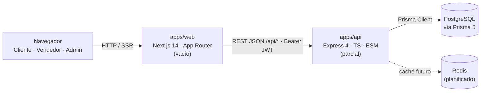
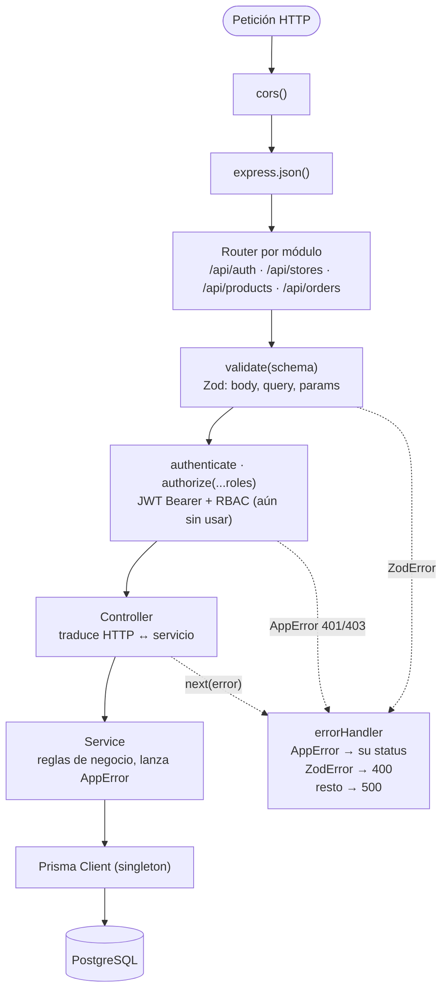
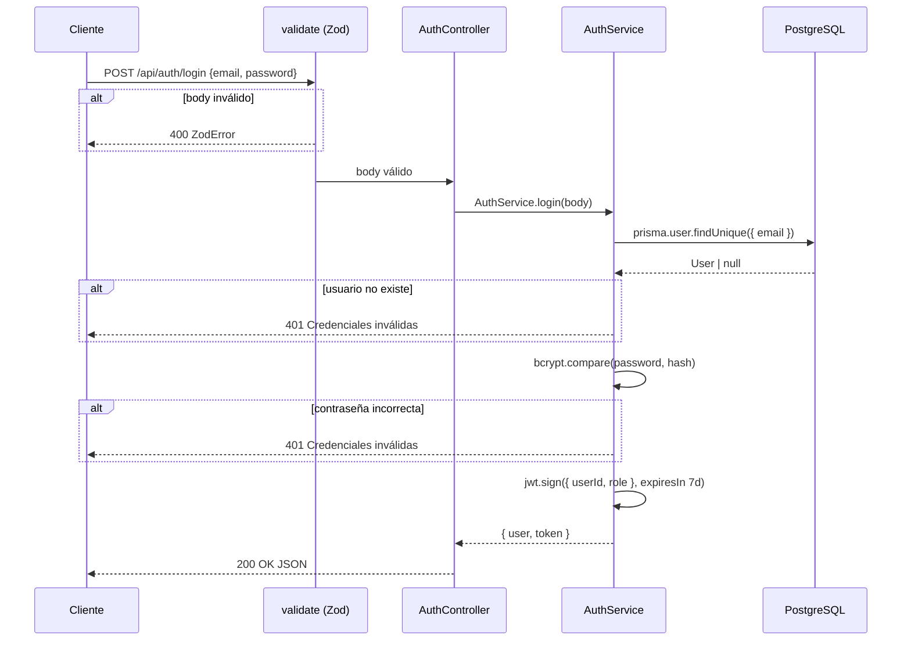
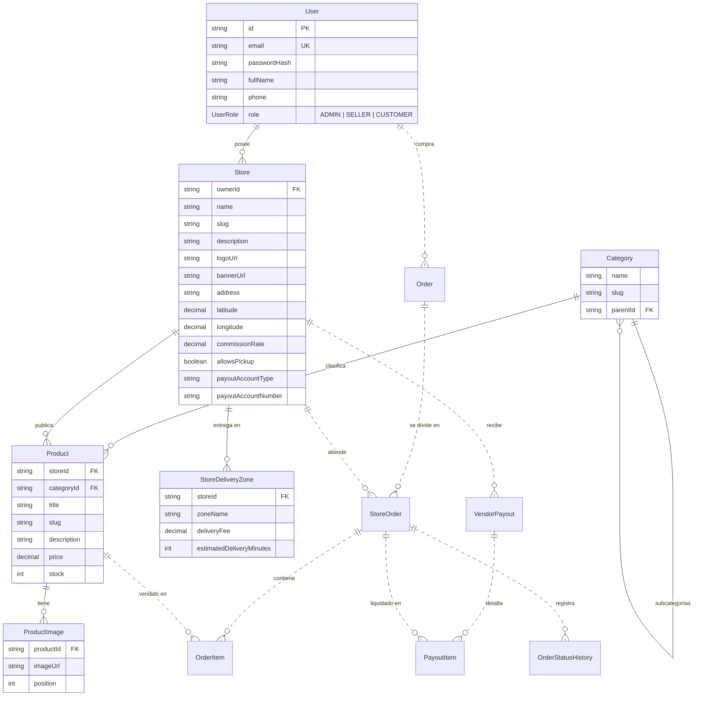

# Marketplace Local · Big picture de arquitectura

> Análisis estático del repositorio (47 archivos fuente, sin `node_modules`) · 30 sep 2026.

## Qué es el sistema

Marketplace multi-vendedor para comercio de barrio (datos de ejemplo en Bogotá, precios en COP): tiendas geolocalizadas con zonas de entrega, comisión por tienda y liquidaciones a vendedores. Tres actores: **cliente**, **vendedor** y **administrador**.

**Estilo arquitectónico:** monorepo con dos apps (sin tooling de workspaces), backend como monolito modular por features con arquitectura en capas, y frontend Next.js segmentado por rol.

**Estado:** esqueleto temprano.

| Indicador | Valor |
| --- | --- |
| Módulos API implementados | 1 / 4 |
| Modelos de dominio en `schema.prisma` | 1 / 12 |
| Archivos fuente vacíos | 25 / 47 |
| Líneas de código en el frontend | 0 |

## Vista de contexto

Las líneas discontinuas son piezas vacías o solo planificadas.



## Estructura del repositorio

```text
marketplace-local/
└─ apps/
   ├─ api/                        Express 4 · Prisma 5 · Zod · JWT · bcrypt (ESM)
   │  ├─ prisma/
   │  │  ├─ schema.prisma         1 modelo (User)
   │  │  └─ seed.ts               usa 12 modelos  ← desalineado
   │  └─ src/
   │     ├─ server.ts             entrypoint: app.listen(PORT)
   │     ├─ app.ts                middlewares globales + montaje de rutas
   │     ├─ index.ts              vacío
   │     ├─ config/               env.ts (Zod) · db.ts (Prisma singleton) · redis.ts vacío
   │     ├─ common/
   │     │  ├─ errors/            AppError · errorHandler
   │     │  ├─ middlewares/       authenticate · authorize · validate
   │     │  └─ utils/             bcrypt · jwt
   │     └─ modules/              un módulo = routes · controller · service · schema
   │        ├─ auth/              completo
   │        ├─ stores/            solo routes (stub)
   │        ├─ products/          solo routes (stub)
   │        └─ orders/            solo routes (stub)
   └─ web/                        Next.js 14 · React 18  (todos los archivos vacíos)
      └─ src/
         ├─ app/                  layout · (public) · checkout · vendor · admin
         ├─ hooks/                use-auth · use-cart
         └─ lib/                  api-client · utils
```

## Stack tecnológico

| Capa | Tecnología |
| --- | --- |
| Runtime API | Node.js · TypeScript 5 · ESM (`tsx watch` en dev) |
| HTTP | Express 4 · cors · express.json |
| Validación | Zod 3 (env + body/query/params) |
| Auth | jsonwebtoken (7 días) · bcrypt (10 rondas) |
| Persistencia | Prisma 5 → PostgreSQL |
| Caché | Redis (solo `REDIS_URL`, sin cliente) |
| Frontend | Next.js 14 App Router · React 18 |

## Backend: pipeline de una petición

Cada módulo sigue el mismo patrón: **routes** (middlewares) → **controller** (HTTP) → **service** (negocio) → Prisma. Los errores se propagan con `next()` hasta un único manejador global.



| # | Componente | Archivo | Responsabilidad |
| --: | --- | --- | --- |
| 1 | `cors()` | `app.ts` | CORS abierto a cualquier origen |
| 2 | `express.json()` | `app.ts` | Parseo del body JSON |
| 3 | Router por módulo | `app.ts` | `/api/auth` · `/api/stores` · `/api/products` · `/api/orders` |
| 4 | `validate(schema)` | `common/middlewares/validate.middleware.ts` | Valida `{ body, query, params }` con Zod |
| 5 | `authenticate` · `authorize(...roles)` | `common/middlewares/auth.middleware.ts` | JWT Bearer + RBAC (definidos, aún sin usar) |
| 6 | Controller | `modules/*/*.controller.ts` | Clase con métodos estáticos; traduce HTTP ↔ servicio |
| 7 | Service | `modules/*/*.service.ts` | Reglas de negocio; lanza `AppError(mensaje, status)` |
| 8 | Prisma Client | `config/db.ts` | Singleton (cacheado en `global` fuera de producción) |
| 9 | `errorHandler` | `common/errors/errorHandler.ts` | `AppError` → su status · `ZodError` → 400 con detalles · resto → 500 |

## Módulos del API

| Módulo | Prefijo | Endpoints | Capas con código | Estado |
| --- | --- | --- | --- | --- |
| auth | `/api/auth` | `POST /register` · `POST /login` | routes · controller · service · schema | Implementado |
| stores | `/api/stores` | `GET /` → `{ stores: [] }` | routes (stub) | Stub |
| products | `/api/products` | `GET /` → `{ products: [] }` | routes (stub) | Stub |
| orders | `/api/orders` | `GET /` → `{ orders: [] }` | routes (stub) | Stub |

## Flujo de autenticación (login)

El registro sigue el mismo camino: verifica email duplicado (409), hashea con bcrypt, crea el `User` y devuelve el token. Las rutas protegidas leerían `Authorization: Bearer <token>` con `authenticate` y filtrarían por rol con `authorize`.



## Modelo de dominio objetivo

Reconstruido a partir de `prisma/seed.ts` (el `schema.prisma` actual solo tiene `User`). Las relaciones con línea sólida están confirmadas por el seed; las punteadas son **inferidas** del orden de borrado y de los nombres de los modelos. Las entidades sin atributos solo aparecen en la limpieza del seed (`deleteMany`), así que sus campos aún no están definidos.



| Entidad | Propósito | Origen |
| --- | --- | --- |
| User | Cuenta única para los tres actores; el rol decide el acceso (RBAC vía JWT) | Confirmado |
| Category | Árbol de categorías con autorrelación (`parentId`) | Confirmado |
| Store | Tienda de un vendedor: geolocalizada, con comisión propia y datos para liquidaciones | Confirmado |
| StoreDeliveryZone | Zonas de entrega por tienda con costo y tiempo estimado | Confirmado |
| Product | Producto publicado por una tienda dentro de una categoría | Confirmado |
| ProductImage | Galería ordenada de imágenes del producto | Confirmado |
| Order | Pedido del cliente en el checkout; puede incluir productos de varias tiendas | Inferido |
| StoreOrder | Sub-pedido por tienda; divide un `Order` multi-vendedor y aplica zona de envío y comisión | Inferido |
| OrderItem | Línea de producto (cantidad y precio congelado al comprar) | Inferido |
| OrderStatusHistory | Bitácora de cambios de estado del pedido | Inferido |
| VendorPayout | Liquidación periódica al vendedor descontando `commissionRate` | Inferido |
| PayoutItem | Detalle de qué sub-pedidos incluye cada liquidación | Inferido |

## Frontend (`apps/web`)

La estructura de rutas ya refleja los tres actores, pero ningún archivo tiene contenido todavía.

| Ruta / pieza | Archivo | Audiencia / propósito |
| --- | --- | --- |
| `/` | `app/(public)/page.tsx` | Catálogo público de tiendas y productos |
| `/checkout` | `app/checkout/page.tsx` | Cliente: carrito → pedido (multi-tienda) |
| `/vendor` | `app/vendor/page.tsx` | Panel del vendedor: tienda, productos, pedidos |
| `/admin` | `app/admin/page.tsx` | Panel de administración |
| layout | `app/layout.tsx` | Layout raíz |
| use-auth | `hooks/use-auth.ts` | Sesión y JWT en el cliente |
| use-cart | `hooks/use-cart.ts` | Estado del carrito |
| api-client | `lib/api-client.ts` | Cliente HTTP hacia `/api/*` |

## Hallazgos y riesgos

> **Crítico: el modelo de datos está partido en dos.** `schema.prisma` define solo `User` (campo `password`, enum `Role`: USER | VENDOR | ADMIN), mientras `seed.ts` usa 12 modelos, los campos `passwordHash`, `fullName` y `phone`, y el enum `UserRole`: ADMIN | SELLER | CUSTOMER. El seed no compila y `auth.service.ts` quedará roto en cuanto se complete el schema.

| Severidad | Hallazgo | Dónde | Impacto |
| --- | --- | --- | --- |
| Alta | Tres vocabularios de roles distintos | `schema.prisma` · `auth.schema.ts` · `seed.ts` | El RBAC (`authorize`) será inconsistente |
| Alta | `tsconfig.json` vacío en api y web | `apps/*/tsconfig.json` | Con `"type": "module"` e imports `.js`, `tsc` no compila como se espera |
| Media | No hay `.gitignore`; el repo git es `D:/gitRepo` (sin commits) | raíz | `.env` con `JWT_SECRET` y `DATABASE_URL` podría versionarse |
| Media | El registro permite elegir el rol `VENDOR` | `auth.schema.ts` | Cualquiera se auto-registra como vendedor sin aprobación |
| Media | URLs del seed con formato markdown `[url](url)` | `seed.ts` (logo, banner, imágenes) | Se guardarían URLs inválidas |
| Media | `authenticate` / `authorize` no se usan en ninguna ruta | `auth.middleware.ts` | No hay endpoints protegidos todavía |
| Media | `errorHandler` no mapea errores de Prisma (p. ej. `P2002`) | `errorHandler.ts` | Conflictos de unicidad responden 500 |
| Baja | Redis declarado pero sin cliente ni uso | `env.ts` · `redis.ts` | Dependencia fantasma |
| Baja | Sin `package.json` raíz, tipos compartidos, docker-compose ni tests | monorepo | Fricción para levantar y mantener el proyecto |
| Baja | Faltan scripts de migración y seed; `.env.example` e `index.ts` vacíos | `apps/api/package.json` | Onboarding manual |

## Ruta sugerida

### 1. Cimientos

- Completar `schema.prisma` con los 12 modelos y un único enum de roles.
- Configurar `tsconfig` (NodeNext en el API), `.gitignore` y `.env.example`.
- Workspaces en la raíz, docker-compose con Postgres, scripts `migrate` y `seed`.

### 2. Dominio backend

- Alinear `auth` con el nuevo `User` (`passwordHash`, `fullName`, `phone`, roles).
- Implementar `stores`, `products` y `orders` con el patrón routes → controller → service.
- Checkout que divida `Order` en `StoreOrder`s; luego liquidaciones (payouts).

### 3. Frontend

- `api-client` tipado y `use-auth` con el JWT.
- Catálogo público y carrito multi-tienda (`use-cart`).
- Paneles de vendedor y administración protegidos por rol.
