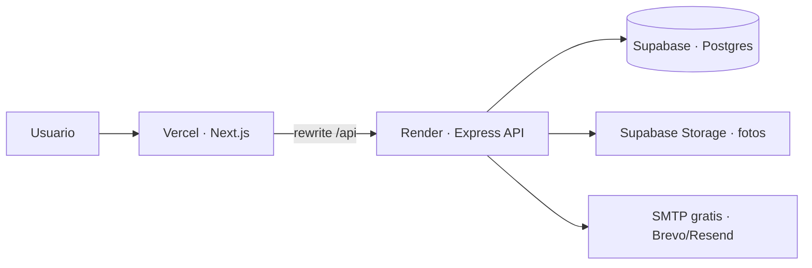

# Plan de despliegue · producción gratuita

Guía para publicar **Tu Comercio Local** con lo que ya está construido en este monorepo, usando **tiers gratuitos** (con límites). No es un plan de escala empresarial: es el camino más barato para una demo / MVP en internet.

## Qué tenés hoy

| Pieza | Ubicación | Notas para producción |
|-------|-----------|------------------------|
| Web | `apps/web` · Next.js 14 | Proxy `/api/*` → API (`next.config.mjs`). Cookies en el mismo dominio de la web. |
| API | `apps/api` · Express + Prisma | JWT, rate-limit, helmet. Sube imágenes a disco local (`uploads/`). |
| Base | `apps/api/prisma/marketplace-db` | Migraciones SQL **pensadas para Supabase** (RLS, `auth.uid()`, storage). |
| Correo | `SMTP_*` en `.env` | Opcional; recuperar contraseña. |
| Redis | `REDIS_URL` | Opcional; hoy no es obligatorio. |



## Recomendación (todo gratis / freemium)

| Rol | Servicio | Plan | Por qué encaja |
|-----|----------|------|----------------|
| **PostgreSQL + Storage** | [Supabase](https://supabase.com) | Free | Tus migraciones ya son de Supabase; Storage reemplaza el disco `uploads/`. |
| **Web (Next.js)** | [Vercel](https://vercel.com) | Hobby | Ideal para Next 14; HTTPS y dominio gratis `*.vercel.app`. |
| **API (Express)** | [Render](https://render.com) | Free Web Service | Corre Node 24/7 con *spin-down* (~15 min sin tráfico → frío al despertar). |
| **Correo** | [Brevo](https://www.brevo.com) o [Resend](https://resend.com) | Free | SMTP para recuperar contraseña. |
| **Dominio** (opcional) | Freenom / Namecheap promo / el que ya tengas | — | Después apuntás `app.` a Vercel y `api.` a Render. |

### Alternativas si algo no te cierra

| Si… | Entonces… |
|-----|-----------|
| Preferís DB sin Supabase | [Neon](https://neon.tech) o [Railway](https://railway.app) Postgres free/trial; aplicás las mismas migraciones con cuidado (roles `auth` / RLS). |
| No querés cold start en el API | Render **Starter** pago, [Fly.io](https://fly.io) con crédito, o Railway trial. |
| Querés todo en un solo sitio | Railway o Render (web + api + db): más simple, menos “gratis para siempre”. |
| Solo demo temporal | [ngrok](https://ngrok.com) / Cloudflare Tunnel sobre tu PC (no es producción real). |

## Limitante crítica: fotos (ya resuelta en código)

En Render el disco es **efímero**. El API ahora usa **Supabase Storage** cuando están estas env:

```env
SUPABASE_URL=https://xxxx.supabase.co
SUPABASE_SERVICE_ROLE_KEY=eyJ...   # Project Settings → API → service_role (secret)
```

- **Con esas vars:** sube/borra en el bucket público `productos` (migración `..._1500_storage_imagenes.sql`) y las URLs son `…/storage/v1/object/public/productos/tiendas/...`.
- **Sin esas vars (dev local):** sigue el disco `apps/api/uploads` + `/api/uploads` (sin cambios en tu flujo actual).

El único módulo que cambia es `apps/api/src/common/utils/images.ts`. El resto del API sigue guardando en la base la **ruta** (`tiendas/<id>/productos/...`), no la URL completa.

### Cómo activarlo al desplegar

1. Proyecto Supabase creado y migraciones aplicadas (incluye el bucket `productos`).
2. En Render, cargar `SUPABASE_URL` + `SUPABASE_SERVICE_ROLE_KEY` (nunca en el frontend ni en el repo).
3. Redeploy del API. Subí una foto de prueba desde el panel: debe verse con URL de `*.supabase.co`.
4. No hace falta `express.static` en producción: las imágenes las sirve Supabase.

### Otros límites del camino gratis

1. **Cold start del API (Render Free)**  
   Tras inactividad, la 1.ª petición puede tardar 30–60 s. La web en Vercel sigue rápida; falla o “carga” el proxy hasta que despierte el API.

2. **Cuotas Supabase Free**  
   ~500 MB DB, pausa del proyecto tras ~1 semana sin uso (hay que reactivarlo), límites de Storage/egress. Suficiente para MVP chico.

3. **Vercel Hobby**  
   Bien para tráfico bajo; builds y serverless limits del plan free.

4. **SMTP**  
   Sin `SMTP_HOST` en producción el API **no ofrece** recuperar contraseña (ver `env.ts`). Configurá Brevo/Resend antes de lanzar.

## Variables de entorno

### Web (Vercel)

```env
API_URL=https://TU-API.onrender.com
```

(`rewrites` de Next usan esto en **build/runtime del servidor**.)

### API (Render)

```env
NODE_ENV=production
PORT=10000
DATABASE_URL=postgresql://...  # Connection string de Supabase (modo Session o URI)
JWT_SECRET=generá_un_secreto_largo_y_único
WEB_ORIGIN=https://tu-app.vercel.app
# Fotos (obligatorio en Render — sin esto se pierden al reiniciar)
SUPABASE_URL=https://xxxx.supabase.co
SUPABASE_SERVICE_ROLE_KEY=eyJ...
# SMTP (Brevo / Resend)
SMTP_HOST=...
SMTP_PORT=587
SMTP_USER=...
SMTP_PASS=...
MAIL_FROM="Tu Comercio Local <noreply@tudominio.com>"
```

En Supabase: Project Settings → Database → URI. Si usás pooler, preferí el modo compatible con Prisma (a menudo *Session* / puerto 5432).

## Pasos de despliegue (orden sugerido)

### 1. Base en Supabase

1. Crear proyecto en Supabase (región cercana, p. ej. South America si está).
2. Aplicar migraciones de `apps/api/prisma/marketplace-db/supabase/migrations/`  
   - Con **Supabase CLI** (`supabase db push` / link al proyecto), **o**  
   - Ejecutar los `.sql` en orden en el SQL Editor (solo si sabés lo que hacés).
3. Verificar roles / `auth` como en el README de `marketplace-db`.
4. En local (o CI): apuntar `DATABASE_URL` al proyecto, `npm run db:pull` y `npm run db:generate` si hace falta regenerar el cliente.
5. Crear superadmin: registrar un usuario por la web (cuando exista) y `npm run db:superadmin -- correo@...` contra esa DB (script desde una máquina con la URL de prod, con cuidado).
6. (Opcional demo) `npm run db:demo` **solo** si querés datos de prueba en prod (mejor no en un entorno “público serio”).

### 2. API en Render

1. New → Web Service → conectar el repo GitHub/GitLab.
2. Root / build sugerido (ajustar monorepo):
   - **Build:** `npm install && npm run contratos && npm run build -w api && npm run db:generate -w api`
   - **Start:** `npm run start -w api`  
   (Si Render no resuelve workspaces bien, documentar `cd apps/api` + install local, o un `render.yaml`.)
3. Cargar las env de arriba.
4. Health: `GET https://TU-API.onrender.com/api/...` (el endpoint de salud que ya exponga `pkg_sistema`).
5. Plan Free: aceptar spin-down.

### 3. Web en Vercel

1. Importar el mismo monorepo.
2. Root Directory: `apps/web` **o** build desde raíz con:
   - Install: `npm install`
   - Build: `npm run contratos && npm run build -w web`
   - Output: Next por defecto.
3. Env: `API_URL=https://TU-API.onrender.com`
4. Dominio: `*.vercel.app` al principio.
5. Probar login, panel vendedor, un pedido de ejemplo.

### 4. Correo y OAuth (opcional)

- **SMTP:** Brevo/Resend → vars en Render.
- **Google login:** `GOOGLE_CLIENT_ID` + orígenes autorizados = URL de Vercel.
- **Maps:** solo si usás importar local; tiene costo por uso.

### 5. Dominio propio (cuando quieras)

1. `www` / apex → Vercel.
2. `api.` → Render (CNAME).
3. Actualizar `WEB_ORIGIN`, `API_URL`, OAuth y CORS/`WEB_ORIGIN`.

## Trabajo de código antes / durante el deploy

Checklist mínimo para que el free tier no te rompa la demo:

| Prioridad | Tarea | Por qué |
|-----------|--------|---------|
| Alta | ~~Subidas a Supabase Storage~~ **Hecho** (`images.ts` + env) | Configurar `SUPABASE_*` en Render |
| Alta | `render.yaml` o scripts de build claros del monorepo | Evitar fallos de deploy |
| Media | Healthcheck + “wake” (cron externo gratis pegándole al API cada 10 min) | Mitigar cold start |
| Media | Confirmar cookies/`WEB_ORIGIN` en prod | Login y sesión |
| Baja | Quitar o proteger datos demo en prod | Seguridad / imagen |
| Baja | Redis real solo si medís necesidad | Hoy es opcional |

## Costos esperados (orden de magnitud)

| Escenario | Costo |
|-----------|--------|
| Solo free tiers, tráfico bajo, demo | **USD 0 / mes** |
| API siempre caliente (Render Starter) | ~USD 7 / mes |
| Dominio .com | ~USD 10–15 / año |
| Google Maps Places con uso real | Variable (pago por request) |

## Qué no hacer en el primer deploy gratis

- No depender de Redis todavía.
- No poner secretos en el repo (`.env` solo en Vercel/Render/Supabase).
- No usar `db:demo` como si fuera producción real con clientes.
- No esperar rendimiento de app grande: es un MVP en freemium.

## Criterio de “ya está en producción”

- [ ] Migraciones aplicadas en Supabase
- [ ] API responde en HTTPS (Render)
- [ ] Web en Vercel abre el marketplace
- [ ] Registro / login / sesión OK
- [ ] Al menos una tienda y un producto visibles
- [ ] `SUPABASE_URL` + `SUPABASE_SERVICE_ROLE_KEY` en el API y una foto de prueba OK
- [ ] Recuperar contraseña con SMTP **o** desactivado a propósito

---

**Resumen:** lo más alineado con este repo es **Supabase (DB + Storage) + Vercel (web) + Render (API) + Brevo/Resend (mail)**. Empezá por Supabase, después API, después web.
