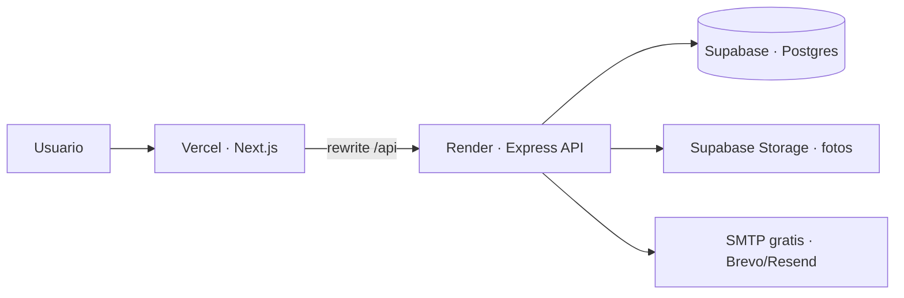

# Plan de despliegue · producción gratuita

Guía para publicar **Tu Comercio Local** con lo que ya está construido en este monorepo, usando **tiers gratuitos** (con límites). No es un plan de escala empresarial: es el camino más barato para una demo / MVP en internet.

## Estado del plan (QA → prod)

| Paso | Pieza | Estado |
|------|--------|--------|
| 1 | Base + Storage en **Supabase** (migraciones, bucket `productos`) | **Hecho** |
| 2 | API en **Render** (HTTPS + env + health) | **En curso** |
| 3 | Web en **Vercel** (`API_URL` → Render) | Pendiente |
| 4 | Superadmin + smoke QA (login, tienda, foto) | Pendiente |
| 5 | SMTP (Brevo/Resend) opcional | Pendiente |
| 6 | Dominio propio (opcional) | Pendiente |

## Qué tenés hoy

| Pieza | Ubicación | Notas para producción |
|-------|-----------|------------------------|
| Web | `apps/web` · Next.js 14 | Proxy `/api/*` → API (`next.config.mjs`). Cookies en el mismo dominio de la web. |
| API | `apps/api` · Express + Prisma | JWT, rate-limit, helmet. Fotos: disco local **o** Supabase Storage según env. |
| Base | `apps/api/prisma/marketplace-db` | Migraciones SQL **pensadas para Supabase** (RLS, `auth.uid()`, storage). |
| Correo | `SMTP_*` en `.env` | Opcional; recuperar contraseña. |
| Redis | `REDIS_URL` | Opcional; hoy no es obligatorio. |



## Recomendación (todo gratis / freemium)

| Rol | Servicio | Plan | Por qué encaja |
|-----|----------|------|----------------|
| **PostgreSQL + Storage** | [Supabase](https://supabase.com) | Free | Tus migraciones ya son de Supabase; Storage reemplaza el disco `uploads/`. |
| **Web (Next.js)** | [Vercel](https://vercel.com) | Hobby | Ideal para Next 14; HTTPS y dominio gratis `*.vercel.app`. |
| **API (Express)** | [Render](https://render.com) | Free Web Service | Corre Node 24/7 con *spin-down* (~15 min sin tráfico → frío al despertar). |
| **Correo** | [Brevo](https://www.brevo.com) o [Resend](https://resend.com) | Free | SMTP para recuperar contraseña. |
| **Dominio** (opcional) | Freenom / Namecheap promo / el que ya tengas | — | Después apuntás `app.` a Vercel y `api.` a Render. |

### Alternativas si algo no te cierra

| Si… | Entonces… |
|-----|-----------|
| Preferís DB sin Supabase | [Neon](https://neon.tech) o [Railway](https://railway.app) Postgres free/trial; aplicás las mismas migraciones con cuidado (roles `auth` / RLS). |
| No querés cold start en el API | Render **Starter** pago, [Fly.io](https://fly.io) con crédito, o Railway trial. |
| Querés todo en un solo sitio | Railway o Render (web + api + db): más simple, menos “gratis para siempre”. |
| Solo demo temporal | [ngrok](https://ngrok.com) / Cloudflare Tunnel sobre tu PC (no es producción real). |

## Limitante crítica: fotos (ya resuelta en código)

En Render el disco es **efímero**. El API ahora usa **Supabase Storage** cuando están estas env:

```env
SUPABASE_URL=https://xxxx.supabase.co
SUPABASE_SERVICE_ROLE_KEY=eyJ...   # Project Settings → API → service_role (secret)
```

- **Con esas vars:** sube/borra en el bucket público `productos` (migración `..._1500_storage_imagenes.sql`) y las URLs son `…/storage/v1/object/public/productos/tiendas/...`.
- **Sin esas vars (dev local):** sigue el disco `apps/api/uploads` + `/api/uploads` (sin cambios en tu flujo actual).

El único módulo que cambia es `apps/api/src/common/utils/images.ts`. El resto del API sigue guardando en la base la **ruta** (`tiendas/<id>/productos/...`), no la URL completa.

### Cómo activarlo al desplegar

1. Proyecto Supabase creado y migraciones aplicadas (incluye el bucket `productos`).
2. En Render, cargar `SUPABASE_URL` + `SUPABASE_SERVICE_ROLE_KEY` (nunca en el frontend ni en el repo).
3. Redeploy del API. Subí una foto de prueba desde el panel: debe verse con URL de `*.supabase.co`.
4. No hace falta `express.static` en producción: las imágenes las sirve Supabase.

### Otros límites del camino gratis

1. **Cold start del API (Render Free)**  
   Tras inactividad, la 1.ª petición puede tardar 30–60 s. La web en Vercel sigue rápida; falla o “carga” el proxy hasta que despierte el API.

2. **Cuotas Supabase Free**  
   ~500 MB DB, pausa del proyecto tras ~1 semana sin uso (hay que reactivarlo), límites de Storage/egress. Suficiente para MVP chico.

3. **Vercel Hobby**  
   Bien para tráfico bajo; builds y serverless limits del plan free.

4. **SMTP**  
   Sin `SMTP_HOST` en producción el API **no ofrece** recuperar contraseña (ver `env.ts`). Configurá Brevo/Resend antes de lanzar.

## Variables de entorno del API (local vs Supabase)

En `apps/api` hay un archivo por ambiente (no se versionan):

| Archivo | Uso | Comando |
|---------|-----|---------|
| `.env.local` | PostgreSQL en tu PC | `npm run dev` / `npm run db:demo` |
| `.env.supabase` | Proyecto Supabase | `npm run dev:supabase` / `npm run db:demo:supabase` |

Plantillas: `.env.local.example` y `.env.supabase.example`.  
`APP_ENV` elige el archivo (`local` por defecto).

En **Render** no hace falta `APP_ENV` ni archivos `.env*`: las variables se cargan en el panel (o Blueprint) y `process.env` ya las trae. `dotenv` no pisa valores que ya existen.

## Variables de entorno (producción)

### Web (Vercel) · Environment Variables

| Variable | Valor |
|----------|--------|
| `API_URL` | `https://TU-API.onrender.com` (URL pública del Web Service en Render) |

(`rewrites` de Next usan esto en **build/runtime del servidor**.)

### API (Render) · Environment Variables

En el servicio `tu-comercio-local-api` → **Environment** (o al completar el Blueprint).  
Podés copiar los valores desde `apps/api/.env.supabase` (ese archivo **no** se sube al repo).

#### Obligatorias (arranque + fotos)

| Variable | Qué poner |
|----------|-----------|
| `NODE_ENV` | `production` |
| `DATABASE_URL` | URI de Postgres de Supabase (Session / pooler). Misma idea que en `.env.supabase`. Project Settings → Database → URI |
| `JWT_SECRET` | Secreto largo y único (o **Generate** en Render) |
| `WEB_ORIGIN` | URL de la web. Hasta Vercel: `http://localhost:3001`. Después: `https://tu-app.vercel.app` |
| `SUPABASE_URL` | `https://TU_PROJECT_REF.supabase.co` |
| `SUPABASE_SERVICE_ROLE_KEY` | Supabase → Settings → API → `service_role` (**secret**; no uses la clave `anon`) |

Sin `SUPABASE_URL` + `SUPABASE_SERVICE_ROLE_KEY` las fotos se pierden en cada reinicio de Render (disco efímero).

#### Opcionales (después)

| Variable | Cuándo |
|----------|--------|
| `SMTP_HOST` | Recuperar contraseña (Brevo / Resend) |
| `SMTP_PORT` | Suele ser `587` |
| `SMTP_USER` / `SMTP_PASS` | Credenciales SMTP |
| `MAIL_FROM` | Ej. `Tu Comercio Local <noreply@tudominio.com>` |
| `GOOGLE_CLIENT_ID` | Login con Google |

#### No hace falta cargar

| Variable | Motivo |
|----------|--------|
| `PORT` | Lo asigna Render solo; el API lee `process.env.PORT` |
| `APP_ENV` | En Render no se usan `.env.local` / `.env.supabase` |
| `REDIS_URL` | Opcional y no requerido en este MVP |

Si usás pooler de Supabase, preferí el modo compatible con Prisma (a menudo *Session* / puerto `5432`).

## Pasos de despliegue (orden sugerido)

### 1. Base en Supabase — hecho

1. Proyecto creado; migraciones de `apps/api/prisma/marketplace-db/supabase/migrations/` aplicadas.
2. Bucket `productos` (Storage) disponible.
3. Tenés a mano: `DATABASE_URL`, `SUPABASE_URL`, `SUPABASE_SERVICE_ROLE_KEY`.

Opcional en máquina local (QA contra la misma DB):

- `apps/api/.env.supabase` + `npm run dev:supabase -w api`
- Registrar usuario → `npm run db:superadmin:supabase -- correo@...`
- (Demo) `npm run db:demo:supabase` solo si querés datos de prueba en ese proyecto

### 2. API en Render — en curso

Hay dos formas equivalentes. Preferí **Blueprint** (`render.yaml` en la raíz del repo).

#### 2.A · Blueprint (recomendado)

1. Subí a GitHub los cambios que incluyen `render.yaml` (y este doc).
2. [Render Dashboard](https://dashboard.render.com) → **New** → **Blueprint** → conectar `bfabra/marketplace-local` (o tu fork).
3. Render lee `render.yaml` y crea el servicio `tu-comercio-local-api` (plan Free, región `oregon`).
4. Completá las env marcadas como *sync: false* (secretos):

   | Variable | De dónde |
   |----------|----------|
   | `DATABASE_URL` | Supabase → Project Settings → Database → URI (Session/pooler) |
   | `WEB_ORIGIN` | URL de Vercel cuando exista; mientras tanto `http://localhost:3001` solo para smoke del health (login real conviene esperar Vercel) |
   | `SUPABASE_URL` | `https://<project-ref>.supabase.co` |
   | `SUPABASE_SERVICE_ROLE_KEY` | Supabase → Settings → API → `service_role` (**secret**) |
   | SMTP_* / `GOOGLE_CLIENT_ID` | Opcional; podés dejarlas vacías al inicio |

   `JWT_SECRET` lo puede generar Render (`generateValue`).

5. Deploy. Esperá el build (instala workspaces → `prisma generate` → `tsc`).
6. Health: `GET https://<servicio>.onrender.com/api/health`  
   Respuesta esperada: `{ "ok": true, "db": "conectada", ... }`.  
   La 1.ª vez puede tardar ~1 min (cold start Free).

#### 2.B · Web Service manual (sin Blueprint)

1. **New** → **Web Service** → mismo repo.
2. Ajustes:

   | Campo | Valor |
   |-------|--------|
   | Runtime | Node |
   | Plan | Free |
   | Root Directory | *(vacío = raíz del monorepo)* |
   | Build Command | `NPM_CONFIG_PRODUCTION=false npm install && npm run build -w api` |
   | Start Command | `npm run start -w api` |
   | Health Check Path | `/api/health` |

   El `prebuild` del API ya corre `contratos` + `db:generate` **antes** de `tsc`.

3. Mismas env que en 2.A.
4. Deploy + health como arriba.

#### Notas técnicas Render

- **`NPM_CONFIG_PRODUCTION=false`**: hace falta para instalar `typescript` / `prisma` (devDependencies) durante el build aunque `NODE_ENV=production`.
- **Orden del build**: primero `prisma generate`, después `tsc`. Si generás después (o no generás), falla con `Property 'sql' does not exist on type 'typeof Prisma'` (TS2339).
- **`start` sale con código 1**: casi siempre faltan o están mal las Environment Variables. En los logs buscá `[env] Variables de entorno inválidas` (lista el campo). Obligatorias: `DATABASE_URL`, `JWT_SECRET`; recomendadas: `WEB_ORIGIN`, `SUPABASE_URL` + `SUPABASE_SERVICE_ROLE_KEY`. No dejes keys creadas con valor vacío (borralas o completalas). Si la clave de Postgres tiene `@ # % & / ?`, codificala en la URI (`@` → `%40`).
- **`trust proxy`**: en producción el API confía 1 hop (proxy de Render) para rate-limit e IPs (`apps/api/src/app.ts`).
- **Cookies `Secure`**: con `NODE_ENV=production` la cookie de sesión solo viaja por HTTPS. El smoke de login conviene hacerlo con la web en **Vercel**, no mezclando `localhost` HTTP → API Render.
- **Cold start Free**: tras ~15 min sin tráfico el servicio se duerme; la 1.ª request despierta (30–60 s). Opcional: cron externo gratis pegándole a `/api/health` cada 10 min.
- **No** versionar `.env` / `.env.supabase` (ya están en `.gitignore`).

### 3. Web en Vercel (siguiente, cuando el API responda health)

1. Importar el mismo monorepo.
2. Root Directory: `apps/web` **o** build desde raíz con:
   - Install: `npm install`
   - Build: `npm run contratos && npm run build -w web`
   - Output: Next por defecto.
3. Env: `API_URL=https://TU-API.onrender.com`
4. Dominio: `*.vercel.app` al principio.
5. Actualizar en Render `WEB_ORIGIN=https://tu-app.vercel.app` y redeploy (o Clear build cache / Manual Deploy).
6. Probar login, panel vendedor, un pedido de ejemplo; subir una foto y confirmar URL `*.supabase.co`.

### 4. Correo y OAuth (opcional)

- **SMTP:** Brevo/Resend → vars en Render.
- **Google login:** `GOOGLE_CLIENT_ID` + orígenes autorizados = URL de Vercel.
- **Maps:** solo si usás importar local; tiene costo por uso.

### 5. Dominio propio (cuando quieras)

1. `www` / apex → Vercel.
2. `api.` → Render (CNAME).
3. Actualizar `WEB_ORIGIN`, `API_URL`, OAuth y CORS/`WEB_ORIGIN`.

## Trabajo de código antes / durante el deploy

Checklist mínimo para que el free tier no te rompa la demo:

| Prioridad | Tarea | Por qué |
|-----------|--------|---------|
| Alta | ~~Subidas a Supabase Storage~~ **Hecho** (`images.ts` + env) | Configurar `SUPABASE_*` en Render |
| Alta | ~~`render.yaml` + build monorepo~~ **Hecho** (raíz del repo) | Evitar fallos de deploy |
| Alta | ~~`trust proxy` en prod~~ **Hecho** | Rate-limit detrás de Render |
| Media | Healthcheck + “wake” (cron externo gratis pegándole al API cada 10 min) | Mitigar cold start |
| Media | Confirmar cookies/`WEB_ORIGIN` en prod (tras Vercel) | Login y sesión |
| Baja | Quitar o proteger datos demo en prod | Seguridad / imagen |
| Baja | Redis real solo si medís necesidad | Hoy es opcional |

## Costos esperados (orden de magnitud)

| Escenario | Costo |
|-----------|--------|
| Solo free tiers, tráfico bajo, demo | **USD 0 / mes** |
| API siempre caliente (Render Starter) | ~USD 7 / mes |
| Dominio .com | ~USD 10–15 / año |
| Google Maps Places con uso real | Variable (pago por request) |

## Qué no hacer en el primer deploy gratis

- No depender de Redis todavía.
- No poner secretos en el repo (`.env` solo en Vercel/Render/Supabase).
- No usar `db:demo` como si fuera producción real con clientes.
- No esperar rendimiento de app grande: es un MVP en freemium.
- No probar login “serio” con web en `http://localhost` contra API Render (`Secure` cookies).

## Criterio de “ya está en producción”

- [x] Migraciones aplicadas en Supabase
- [ ] API responde en HTTPS (Render) → `GET /api/health`
- [ ] Web en Vercel abre el marketplace
- [ ] Registro / login / sesión OK
- [ ] Al menos una tienda y un producto visibles
- [ ] `SUPABASE_URL` + `SUPABASE_SERVICE_ROLE_KEY` en el API y una foto de prueba OK
- [ ] Recuperar contraseña con SMTP **o** desactivado a propósito

---

**Resumen:** **Supabase (DB + Storage) + Vercel (web) + Render (API) + Brevo/Resend (mail)**. Orden: Supabase → **Render (ahora)** → Vercel → smoke QA.
