# Modelo de datos · Tu Comercio Local

> Documento generado automáticamente desde la base de datos con `npm run db:docs` (en `apps/api`).
> No editar a mano: los cambios van en una migración nueva y después se vuelve a generar.

Generado: 6 de octubre de 2026 a las 3:20 p. m.

## Resumen

| Elemento | Cantidad |
|---|---|
| Módulos | 13 |
| Tablas (esquema public) | 50 |
| Campos | 406 |
| Relaciones (claves foráneas) | 92 |
| Tipos enumerados | 20 |
| Índices adicionales | 108 |
| Triggers | 90 |
| Políticas RLS | 107 |
| Tablas sin RLS | 0 |

## Cómo leer este documento

- **Tipo**: tipo de dato en PostgreSQL.
- **Longitud / precisión**: cuánto puede guardar el campo.
  - `text` no tiene largo fijo en PostgreSQL: cuando hay un límite, viene de una regla CHECK.
  - `numeric(12,2)` admite 12 dígitos en total, 2 de ellos decimales.
- **Nulo**: "Sí" si el campo puede quedar vacío.
- **Clave**:
  - **PK**: clave primaria.
  - **FK**: referencia a otra tabla.
  - **Único**: no se puede repetir.
- **Referencia**: tabla y campo al que apunta la FK, y qué pasa si se borra el registro apuntado.
- **Reglas**: restricciones CHECK del campo.
- **RLS**: seguridad por fila. Cada tabla tiene políticas que deciden quién ve o modifica cada registro.

## Índice

1. **Módulo 1 · Base, identidad y ubicación**: [provincias](#tabla-provincias), [localidades](#tabla-localidades), [perfiles](#tabla-perfiles), [direcciones](#tabla-direcciones), [roles_plataforma](#tabla-roles_plataforma)
2. **Módulo 2 · Tiendas y planes**: [planes](#tabla-planes), [tiendas](#tabla-tiendas), [suscripciones](#tabla-suscripciones), [pagos_suscripcion](#tabla-pagos_suscripcion), [cuentas_mp_tienda](#tabla-cuentas_mp_tienda)
3. **Módulo 3 · Equipo y permisos**: [permisos](#tabla-permisos), [roles_tienda](#tabla-roles_tienda), [roles_permisos](#tabla-roles_permisos), [miembros_tienda](#tabla-miembros_tienda), [invitaciones](#tabla-invitaciones)
4. **Módulo 4 · Catálogo**: [categorias](#tabla-categorias), [atributos](#tabla-atributos), [atributo_opciones](#tabla-atributo_opciones), [categorias_atributos](#tabla-categorias_atributos), [productos](#tabla-productos), [producto_atributos](#tabla-producto_atributos), [variantes](#tabla-variantes), [variante_opciones](#tabla-variante_opciones), [imagenes_producto](#tabla-imagenes_producto)
5. **Módulo 5 · Compras y pedidos**: [carritos](#tabla-carritos), [carrito_items](#tabla-carrito_items), [pedidos](#tabla-pedidos), [pedidos_tienda](#tabla-pedidos_tienda), [pedido_items](#tabla-pedido_items), [reservas_stock](#tabla-reservas_stock), [historial_estados](#tabla-historial_estados)
6. **Módulo 6 · Pagos de ventas (Mercado Pago)**: [pagos](#tabla-pagos), [reembolsos](#tabla-reembolsos)
7. **Módulo 7 · Logística (a cargo de la plataforma)**: [tarifas_envio](#tabla-tarifas_envio), [repartidores](#tabla-repartidores), [envios](#tabla-envios), [recolecciones](#tabla-recolecciones)
8. **Módulo 8 · Comunicación**: [preguntas](#tabla-preguntas), [mensajes_pedido](#tabla-mensajes_pedido), [reclamos](#tabla-reclamos), [denuncias](#tabla-denuncias), [notificaciones](#tabla-notificaciones), [solicitudes_consumidor](#tabla-solicitudes_consumidor)
9. **Módulo 9 · Administración**: [auditoria](#tabla-auditoria), [configuracion](#tabla-configuracion)
10. **20261001002400_favoritos_portada_busqueda.sql**: [favoritos](#tabla-favoritos)
11. **20261001002900_usuarios_bloqueos.sql**: [bloqueos_cuenta](#tabla-bloqueos_cuenta)
12. **20261001003700_seguir_tiendas.sql**: [seguidores_tienda](#tabla-seguidores_tienda)
13. **20261001004000_rubros.sql**: [rubros](#tabla-rubros), [tienda_especialidades](#tabla-tienda_especialidades)
14. **Esquema auth**: [auth.users](#tabla-auth-users)
15. [Tipos enumerados](#tipos-enumerados)

---

## Módulo 1 · Base, identidad y ubicación

Archivo: `supabase/migrations/20261001000100_base_identidad_ubicacion.sql`

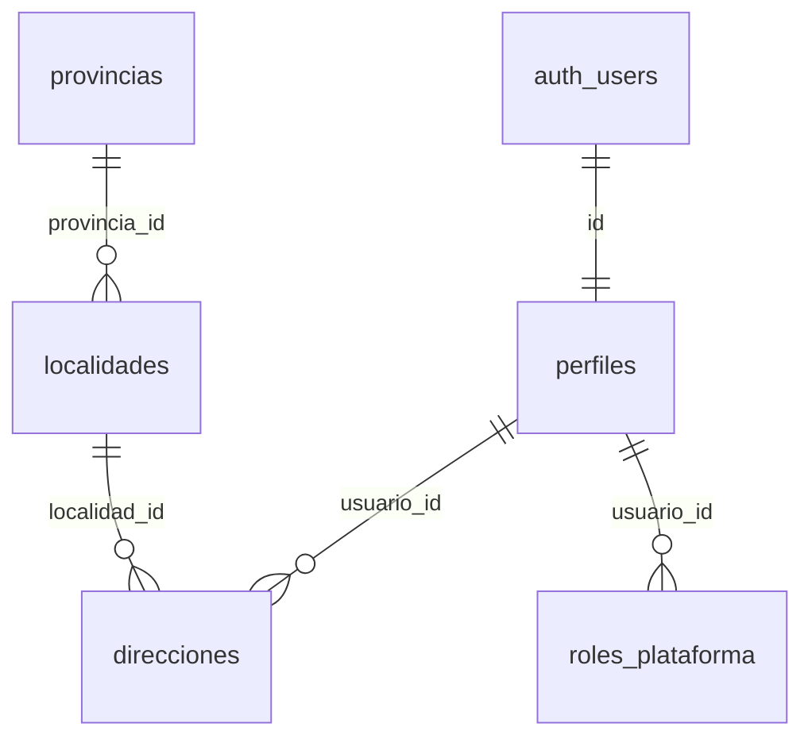

### `provincias`

Ubicación: provincia → localidad San Juan activa al lanzar; otras provincias se agregan como filas, sin cambiar el modelo.

**6 campos** · RLS activo · 2 políticas · 2 triggers

| # | Campo | Tipo | Longitud / precisión | Nulo | Por defecto | Clave | Referencia | Reglas | Descripción |
|---|---|---|---|---|---|---|---|---|---|
| 1 | `id` | `uuid` | 16 bytes (36 caracteres en texto) | No | `gen_random_uuid()` | PK |  |  | Identificador único |
| 2 | `nombre` | `text` | Sin límite fijo | No |  |  |  |  | Nombre |
| 3 | `slug` | `text` | Sin límite fijo | No |  | Único |  |  | Identificador legible para URLs |
| 4 | `activa` | `boolean` | 1 byte (verdadero / falso) | No | `false` |  |  |  | Si está habilitada |
| 5 | `creado_en` | `timestamptz` | 8 bytes (fecha, hora y zona horaria; precisión de microsegundos) | No | `now()` |  |  |  | Fecha y hora de creación |
| 6 | `actualizado_en` | `timestamptz` | 8 bytes (fecha, hora y zona horaria; precisión de microsegundos) | No | `now()` |  |  |  | Última modificación (la actualiza un trigger) |

**Triggers**

- `actualizado_en`: Antes de modificar → `tg_actualizado_en()`
- `auditar`: Después de insertar o borrar o modificar → `tg_auditar()`

Políticas RLS

| Política | Operación | Roles |
|---|---|---|
| provincias: lectura pública | SELECT | anon, authenticated |
| provincias: logística edita | ALL | authenticated |

### `localidades`

**7 campos** · RLS activo · 2 políticas · 2 triggers

| # | Campo | Tipo | Longitud / precisión | Nulo | Por defecto | Clave | Referencia | Reglas | Descripción |
|---|---|---|---|---|---|---|---|---|---|
| 1 | `id` | `uuid` | 16 bytes (36 caracteres en texto) | No | `gen_random_uuid()` | PK |  |  | Identificador único |
| 2 | `provincia_id` | `uuid` | 16 bytes (36 caracteres en texto) | No |  | FK | [provincias.id (sin acción)](#tabla-provincias) |  | Referencia a provincias |
| 3 | `nombre` | `text` | Sin límite fijo | No |  |  |  |  | Nombre |
| 4 | `slug` | `text` | Sin límite fijo | No |  |  |  |  | Identificador legible para URLs |
| 5 | `activa` | `boolean` | 1 byte (verdadero / falso) | No | `true` |  |  |  | Si está habilitada |
| 6 | `creado_en` | `timestamptz` | 8 bytes (fecha, hora y zona horaria; precisión de microsegundos) | No | `now()` |  |  |  | Fecha y hora de creación |
| 7 | `actualizado_en` | `timestamptz` | 8 bytes (fecha, hora y zona horaria; precisión de microsegundos) | No | `now()` |  |  |  | Última modificación (la actualiza un trigger) |

**Reglas de la tabla**

- Combinación única: (provincia_id, slug)

**Índices adicionales**

- `localidades_provincia_id_idx`: `btree (provincia_id)`

**Triggers**

- `actualizado_en`: Antes de modificar → `tg_actualizado_en()`
- `auditar`: Después de insertar o borrar o modificar → `tg_auditar()`

Políticas RLS

| Política | Operación | Roles |
|---|---|---|
| localidades: lectura pública | SELECT | anon, authenticated |
| localidades: logística edita | ALL | authenticated |

### `perfiles`

Perfiles: datos públicos de cada cuenta (la cuenta en sí vive en auth.users) Se crea solo al registrarse. La cuenta es gratuita.

**8 campos** · RLS activo · 6 políticas · 2 triggers

| # | Campo | Tipo | Longitud / precisión | Nulo | Por defecto | Clave | Referencia | Reglas | Descripción |
|---|---|---|---|---|---|---|---|---|---|
| 1 | `id` | `uuid` | 16 bytes (36 caracteres en texto) | No |  | PK, FK | [auth.users.id (borra en cascada)](#tabla-auth-users) |  | Identificador único |
| 2 | `nombre` | `text` | Sin límite fijo | Sí |  |  |  |  | Nombre |
| 3 | `apellido` | `text` | Sin límite fijo | Sí |  |  |  |  | Apellido |
| 4 | `telefono` | `text` | Sin límite fijo | Sí |  |  |  |  | Teléfono |
| 5 | `avatar_url` | `text` | Sin límite fijo | Sí |  |  |  |  | Foto de perfil (URL) |
| 6 | `creado_en` | `timestamptz` | 8 bytes (fecha, hora y zona horaria; precisión de microsegundos) | No | `now()` |  |  |  | Fecha y hora de creación |
| 7 | `actualizado_en` | `timestamptz` | 8 bytes (fecha, hora y zona horaria; precisión de microsegundos) | No | `now()` |  |  |  | Última modificación (la actualiza un trigger) |
| 8 | `ultimo_ingreso` | `timestamptz` | 8 bytes (fecha, hora y zona horaria; precisión de microsegundos) | Sí |  |  |  |  |  |

**Índices adicionales**

- `perfiles_creado_en_idx`: `btree (creado_en DESC)`

**Triggers**

- `actualizado_en`: Antes de modificar → `tg_actualizado_en()`
- `perfiles_control`: Antes de modificar → `tg_perfiles_control()`

Políticas RLS

| Política | Operación | Roles |
|---|---|---|
| perfiles: admin y soporte ven | SELECT | authenticated |
| perfiles: el comercio ve a sus compradores | SELECT | authenticated |
| perfiles: el dueño ve a sus empleados | SELECT | authenticated |
| perfiles: el propio | SELECT | authenticated |
| perfiles: el propio edita | UPDATE | authenticated |
| perfiles: el repartidor ve al cliente de su entrega | SELECT | authenticated |

### `direcciones`

Direcciones de los clientes

**12 campos** · RLS activo · 1 política · 2 triggers

| # | Campo | Tipo | Longitud / precisión | Nulo | Por defecto | Clave | Referencia | Reglas | Descripción |
|---|---|---|---|---|---|---|---|---|---|
| 1 | `id` | `uuid` | 16 bytes (36 caracteres en texto) | No | `gen_random_uuid()` | PK |  |  | Identificador único |
| 2 | `usuario_id` | `uuid` | 16 bytes (36 caracteres en texto) | No |  | FK | [perfiles.id (borra en cascada)](#tabla-perfiles) |  | Referencia a perfiles |
| 3 | `alias` | `text` | Sin límite fijo | Sí |  |  |  |  | Nombre corto de la dirección (ej.: "Casa", "Trabajo") |
| 4 | `calle` | `text` | Sin límite fijo | No |  |  |  |  | Calle |
| 5 | `numero` | `text` | Sin límite fijo | No |  |  |  |  | Altura de la calle |
| 6 | `piso_depto` | `text` | Sin límite fijo | Sí |  |  |  |  | Piso y departamento |
| 7 | `localidad_id` | `uuid` | 16 bytes (36 caracteres en texto) | No |  | FK | [localidades.id (sin acción)](#tabla-localidades) |  | Referencia a localidades |
| 8 | `codigo_postal` | `text` | Sin límite fijo | Sí |  |  |  |  | Código postal |
| 9 | `referencias` | `text` | Sin límite fijo | Sí |  |  |  |  | Indicaciones para el repartidor (entre calles, color de la casa, etc.) |
| 10 | `es_principal` | `boolean` | 1 byte (verdadero / falso) | No | `false` |  |  |  | Indica si es principal |
| 11 | `creado_en` | `timestamptz` | 8 bytes (fecha, hora y zona horaria; precisión de microsegundos) | No | `now()` |  |  |  | Fecha y hora de creación |
| 12 | `actualizado_en` | `timestamptz` | 8 bytes (fecha, hora y zona horaria; precisión de microsegundos) | No | `now()` |  |  |  | Última modificación (la actualiza un trigger) |

**Índices adicionales**

- `direcciones_localidad_id_idx`: `btree (localidad_id)`
- `direcciones_una_principal` (único): `btree (usuario_id) WHERE es_principal`
- `direcciones_usuario_id_idx`: `btree (usuario_id)`

**Triggers**

- `actualizado_en`: Antes de modificar → `tg_actualizado_en()`
- `localidad_disponible`: Antes de insertar o modificar localidad_id → `tg_localidad_disponible()`

Políticas RLS

| Política | Operación | Roles |
|---|---|---|
| direcciones: las propias | ALL | authenticated |

### `roles_plataforma`

Un único superadmin, que delega los demás roles.

**4 campos** · RLS activo · 2 políticas · 1 trigger

| # | Campo | Tipo | Longitud / precisión | Nulo | Por defecto | Clave | Referencia | Reglas | Descripción |
|---|---|---|---|---|---|---|---|---|---|
| 1 | `id` | `uuid` | 16 bytes (36 caracteres en texto) | No | `gen_random_uuid()` | PK |  |  | Identificador único |
| 2 | `usuario_id` | `uuid` | 16 bytes (36 caracteres en texto) | No |  | FK | [perfiles.id (borra en cascada)](#tabla-perfiles) |  | Referencia a perfiles |
| 3 | `rol` | [enum rol_plataforma](#enum-rol_plataforma) | 4 bytes (lista cerrada de valores) | No |  |  |  |  | Rol de administración asignado |
| 4 | `creado_en` | `timestamptz` | 8 bytes (fecha, hora y zona horaria; precisión de microsegundos) | No | `now()` |  |  |  | Fecha y hora de creación |

**Reglas de la tabla**

- Combinación única: (usuario_id, rol)

**Índices adicionales**

- `roles_plataforma_un_superadmin` (único): `btree (rol) WHERE (rol = 'superadmin'::rol_plataforma)`

**Triggers**

- `auditar`: Después de insertar o borrar o modificar → `tg_auditar()`

Políticas RLS

| Política | Operación | Roles |
|---|---|---|
| roles_plataforma: el propio o superadmin | SELECT | authenticated |
| roles_plataforma: solo superadmin asigna | ALL | authenticated |

---

## Módulo 2 · Tiendas y planes

Archivo: `supabase/migrations/20261001000200_tiendas_planes.sql`

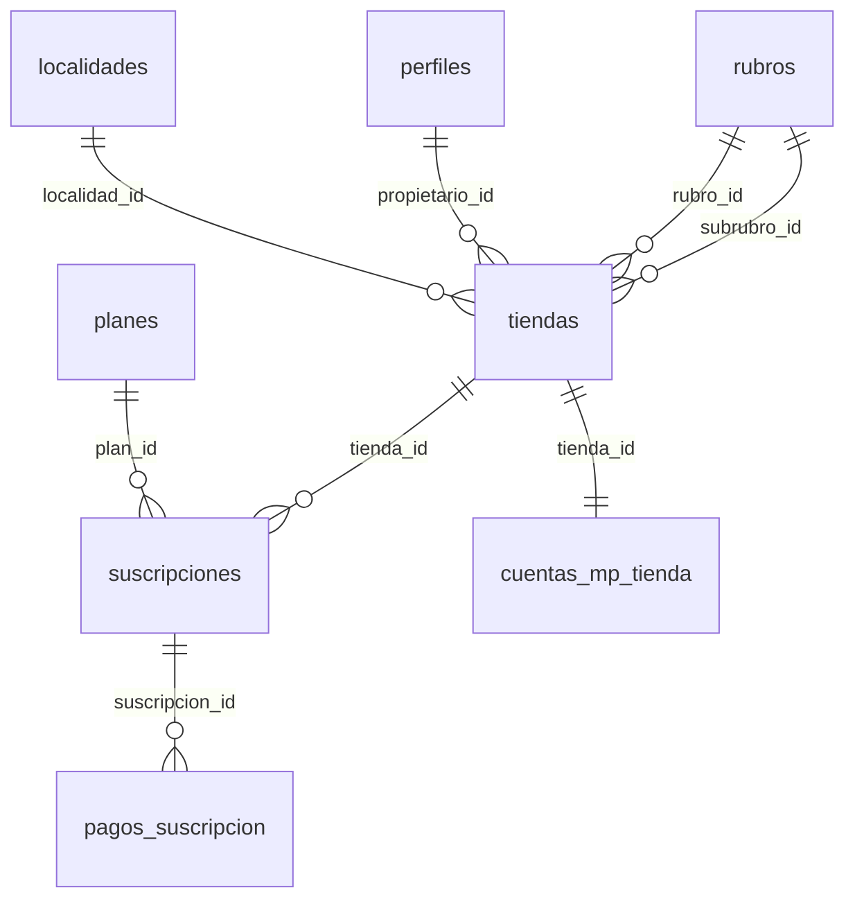

### `planes`

Planes: parametrizables desde el panel admin (null = ilimitado)

**10 campos** · RLS activo · 2 políticas · 2 triggers

| # | Campo | Tipo | Longitud / precisión | Nulo | Por defecto | Clave | Referencia | Reglas | Descripción |
|---|---|---|---|---|---|---|---|---|---|
| 1 | `id` | `uuid` | 16 bytes (36 caracteres en texto) | No | `gen_random_uuid()` | PK |  |  | Identificador único |
| 2 | `nombre` | `text` | Sin límite fijo | No |  | Único |  |  | Nombre |
| 3 | `precio_mensual` | `numeric(12,2)` | 12 dígitos, 2 decimales (máx. 9.999.999.999,99) | No | `0` |  |  | `precio_mensual >= 0` | Precio mensual del plan en pesos (0 = gratis) |
| 4 | `max_productos` | `integer` | 4 bytes (±2.147.483.647) | Sí |  |  |  | `max_productos >= 0` | Null = ilimitado |
| 5 | `max_empleados` | `integer` | 4 bytes (±2.147.483.647) | Sí |  |  |  | `max_empleados >= 0` | Null = ilimitado |
| 6 | `es_gratis` | `boolean` | 1 byte (verdadero / falso) | No | `false` |  |  |  | Indica si es gratis |
| 7 | `activo` | `boolean` | 1 byte (verdadero / falso) | No | `true` |  |  |  | Si está habilitado |
| 8 | `orden` | `integer` | 4 bytes (±2.147.483.647) | No | `0` |  |  |  | Orden en que se muestra |
| 9 | `creado_en` | `timestamptz` | 8 bytes (fecha, hora y zona horaria; precisión de microsegundos) | No | `now()` |  |  |  | Fecha y hora de creación |
| 10 | `actualizado_en` | `timestamptz` | 8 bytes (fecha, hora y zona horaria; precisión de microsegundos) | No | `now()` |  |  |  | Última modificación (la actualiza un trigger) |

**Triggers**

- `actualizado_en`: Antes de modificar → `tg_actualizado_en()`
- `auditar`: Después de insertar o borrar o modificar → `tg_auditar()`

Políticas RLS

| Política | Operación | Roles |
|---|---|---|
| planes: admin edita | ALL | authenticated |
| planes: lectura pública | SELECT | anon, authenticated |

### `tiendas`

**23 campos** · RLS activo · 4 políticas · 7 triggers

| # | Campo | Tipo | Longitud / precisión | Nulo | Por defecto | Clave | Referencia | Reglas | Descripción |
|---|---|---|---|---|---|---|---|---|---|
| 1 | `id` | `uuid` | 16 bytes (36 caracteres en texto) | No | `gen_random_uuid()` | PK |  |  | Identificador único |
| 2 | `propietario_id` | `uuid` | 16 bytes (36 caracteres en texto) | No |  | FK | [perfiles.id (sin acción)](#tabla-perfiles) |  | Única fuente de verdad sobre el dueño. Los empleados van en miembros_tienda. |
| 3 | `nombre` | `text` | Sin límite fijo | No |  |  |  |  | Nombre |
| 4 | `slug` | `text` | Sin límite fijo | No |  | Único |  |  | Identificador legible para URLs |
| 5 | `descripcion` | `text` | Sin límite fijo | Sí |  |  |  |  | Descripción |
| 6 | `logo_url` | `text` | Sin límite fijo | Sí |  |  |  |  | Logo (URL) |
| 7 | `portada_url` | `text` | Sin límite fijo | Sí |  |  |  |  | Imagen de portada (URL) |
| 8 | `cuit` | `text` | Sin límite fijo | No |  |  |  |  | CUIT del comercio |
| 9 | `razon_social` | `text` | Sin límite fijo | Sí |  |  |  |  | Razón social para facturación |
| 10 | `telefono` | `text` | Sin límite fijo | Sí |  |  |  |  | Teléfono |
| 11 | `email` | `text` | Sin límite fijo | Sí |  |  |  |  | Correo electrónico |
| 12 | `localidad_id` | `uuid` | 16 bytes (36 caracteres en texto) | No |  | FK | [localidades.id (sin acción)](#tabla-localidades) |  | Referencia a localidades |
| 13 | `direccion` | `text` | Sin límite fijo | No |  |  |  |  | Dirección del local (donde se retiran los pedidos) |
| 14 | `lat` | `numeric(9,6)` | 9 dígitos, 6 decimales (máx. 999,999999) | Sí |  |  |  |  | Latitud |
| 15 | `lng` | `numeric(9,6)` | 9 dígitos, 6 decimales (máx. 999,999999) | Sí |  |  |  |  | Longitud |
| 16 | `horarios` | `jsonb` | Variable (JSON binario) | No | `'{}'` |  |  |  | Horarios de atención por día, en JSON |
| 17 | `estado` | [enum estado_tienda](#enum-estado_tienda) | 4 bytes (lista cerrada de valores) | No | `'pendiente'` |  |  |  | Estado actual |
| 18 | `creado_en` | `timestamptz` | 8 bytes (fecha, hora y zona horaria; precisión de microsegundos) | No | `now()` |  |  |  | Fecha y hora de creación |
| 19 | `actualizado_en` | `timestamptz` | 8 bytes (fecha, hora y zona horaria; precisión de microsegundos) | No | `now()` |  |  |  | Última modificación (la actualiza un trigger) |
| 20 | `motivo_estado` | `text` | Sin límite fijo | Sí |  |  |  |  |  |
| 21 | `revision_productos` | `text` | Sin límite fijo | No | `'automatica'` |  |  | `revision_productos = ANY (ARRAY['automatica', 'siempre', 'nunca'])` |  |
| 22 | `rubro_id` | `uuid` | 16 bytes (36 caracteres en texto) | Sí |  | FK | [rubros.id (sin acción)](#tabla-rubros) |  | Referencia a rubros |
| 23 | `subrubro_id` | `uuid` | 16 bytes (36 caracteres en texto) | Sí |  | FK | [rubros.id (sin acción)](#tabla-rubros) |  | Referencia a rubros |

**Índices adicionales**

- `tiendas_activas_nombre_idx`: `btree (nombre) WHERE (estado = 'activa'::estado_tienda)`
- `tiendas_estado_creado_en_idx`: `btree (estado, creado_en DESC)`
- `tiendas_localidad_id_idx`: `btree (localidad_id) WHERE (estado = 'activa'::estado_tienda)`
- `tiendas_propietario_id_idx`: `btree (propietario_id)`
- `tiendas_rubro_id_idx`: `btree (rubro_id)`
- `tiendas_subrubro_id_idx`: `btree (subrubro_id)`

**Triggers**

- `actualizado_en`: Antes de modificar → `tg_actualizado_en()`
- `auditar`: Después de insertar o borrar o modificar → `tg_auditar()`
- `localidad_disponible`: Antes de insertar o modificar localidad_id → `tg_localidad_disponible()`
- `tienda_quitar_especialidades`: Después de modificar subrubro_id (si (new.subrubro_id IS DISTINCT FROM old.subrubro_id)) → `tg_tienda_quitar_especialidades()`
- `tienda_rubro`: Antes de insertar o modificar rubro_id, subrubro_id → `tg_tienda_rubro()`
- `tiendas_control`: Antes de insertar o modificar → `tg_tiendas_control()`
- `tiendas_moderacion`: Antes de insertar o modificar → `tg_tiendas_moderacion()`

Políticas RLS

| Política | Operación | Roles |
|---|---|---|
| tiendas: cualquiera con cuenta crea | INSERT | authenticated |
| tiendas: dueño y empleados ven la suya | SELECT | authenticated |
| tiendas: editar con permiso de configuración | UPDATE | authenticated |
| tiendas: las activas son públicas | SELECT | anon, authenticated |

### `suscripciones`

**12 campos** · RLS activo · 2 políticas · 4 triggers

| # | Campo | Tipo | Longitud / precisión | Nulo | Por defecto | Clave | Referencia | Reglas | Descripción |
|---|---|---|---|---|---|---|---|---|---|
| 1 | `id` | `uuid` | 16 bytes (36 caracteres en texto) | No | `gen_random_uuid()` | PK |  |  | Identificador único |
| 2 | `tienda_id` | `uuid` | 16 bytes (36 caracteres en texto) | No |  | FK | [tiendas.id (borra en cascada)](#tabla-tiendas) |  | Referencia a tiendas |
| 3 | `plan_id` | `uuid` | 16 bytes (36 caracteres en texto) | No |  | FK | [planes.id (sin acción)](#tabla-planes) |  | Referencia a planes |
| 4 | `estado` | [enum estado_suscripcion](#enum-estado_suscripcion) | 4 bytes (lista cerrada de valores) | No | `'pendiente'` |  |  |  | Estado actual |
| 5 | `inicio` | `timestamptz` | 8 bytes (fecha, hora y zona horaria; precisión de microsegundos) | No | `now()` |  |  |  | Inicio del período pagado |
| 6 | `fin_periodo` | `timestamptz` | 8 bytes (fecha, hora y zona horaria; precisión de microsegundos) | Sí |  |  |  |  | Null en el plan gratis |
| 7 | `gracia_hasta` | `timestamptz` | 8 bytes (fecha, hora y zona horaria; precisión de microsegundos) | Sí |  |  |  |  | Fin del período de gracia: vencido el plan, la tienda sigue activa hasta esta fecha |
| 8 | `mp_preapproval_id` | `text` | Sin límite fijo | Sí |  |  |  |  | Id del débito automático en Mercado Pago |
| 9 | `creado_en` | `timestamptz` | 8 bytes (fecha, hora y zona horaria; precisión de microsegundos) | No | `now()` |  |  |  | Fecha y hora de creación |
| 10 | `actualizado_en` | `timestamptz` | 8 bytes (fecha, hora y zona horaria; precisión de microsegundos) | No | `now()` |  |  |  | Última modificación (la actualiza un trigger) |
| 11 | `motivo_cancelacion` | `text` | Hasta 500 caracteres | Sí |  |  |  |  |  |
| 12 | `nota_admin` | `text` | Hasta 500 caracteres | Sí |  |  |  |  |  |

**Índices adicionales**

- `suscripciones_estado_fin_idx`: `btree (estado, fin_periodo)`
- `suscripciones_plan_estado_idx`: `btree (plan_id, estado)`
- `suscripciones_plan_id_idx`: `btree (plan_id)`
- `suscripciones_tienda_id_idx`: `btree (tienda_id)`
- `suscripciones_una_vigente` (único): `btree (tienda_id) WHERE (estado = ANY (ARRAY['pendiente'::estado_suscripcion, 'activa'::estado_suscripcion, 'en_gracia'::estado_suscripcion]))`

**Triggers**

- `actualizado_en`: Antes de modificar → `tg_actualizado_en()`
- `auditar`: Después de insertar o borrar o modificar → `tg_auditar()`
- `suscripciones_efectos`: Después de insertar o modificar plan_id, estado → `tg_suscripciones_efectos()`
- `suscripciones_validar`: Antes de insertar o modificar plan_id, estado → `tg_suscripciones_validar()`

Políticas RLS

| Política | Operación | Roles |
|---|---|---|
| suscripciones: el dueño ve las suyas | SELECT | authenticated |
| suscripciones: finanzas edita | ALL | authenticated |

### `pagos_suscripcion`

**9 campos** · RLS activo · 3 políticas · 2 triggers

| # | Campo | Tipo | Longitud / precisión | Nulo | Por defecto | Clave | Referencia | Reglas | Descripción |
|---|---|---|---|---|---|---|---|---|---|
| 1 | `id` | `uuid` | 16 bytes (36 caracteres en texto) | No | `gen_random_uuid()` | PK |  |  | Identificador único |
| 2 | `suscripcion_id` | `uuid` | 16 bytes (36 caracteres en texto) | No |  | FK | [suscripciones.id (borra en cascada)](#tabla-suscripciones) |  | Referencia a suscripciones |
| 3 | `periodo` | `date` | 4 bytes (solo fecha) | No |  |  |  |  | Primer día del mes cobrado |
| 4 | `monto` | `numeric(12,2)` | 12 dígitos, 2 decimales (máx. 9.999.999.999,99) | No |  |  |  | `monto >= 0` | Importe en pesos |
| 5 | `estado` | [enum estado_cobro](#enum-estado_cobro) | 4 bytes (lista cerrada de valores) | No | `'pendiente'` |  |  |  | Estado actual |
| 6 | `mp_payment_id` | `text` | Sin límite fijo | Sí |  | Único |  |  | Id del pago en Mercado Pago (evita registrar dos veces el mismo aviso) |
| 7 | `pagado_en` | `timestamptz` | 8 bytes (fecha, hora y zona horaria; precisión de microsegundos) | Sí |  |  |  |  | Fecha y hora: pagado |
| 8 | `creado_en` | `timestamptz` | 8 bytes (fecha, hora y zona horaria; precisión de microsegundos) | No | `now()` |  |  |  | Fecha y hora de creación |
| 9 | `actualizado_en` | `timestamptz` | 8 bytes (fecha, hora y zona horaria; precisión de microsegundos) | No | `now()` |  |  |  | Última modificación (la actualiza un trigger) |

**Reglas de la tabla**

- Combinación única: (suscripcion_id, periodo)

**Triggers**

- `actualizado_en`: Antes de modificar → `tg_actualizado_en()`
- `auditar`: Después de insertar o borrar o modificar → `tg_auditar()`

Políticas RLS

| Política | Operación | Roles |
|---|---|---|
| pagos_suscripcion: el dueño ve los suyos | SELECT | authenticated |
| pagos_suscripcion: finanzas corrige | UPDATE | authenticated |
| pagos_suscripcion: finanzas registra | INSERT | authenticated |

### `cuentas_mp_tienda`

Cuenta de Mercado Pago vinculada por cada tienda (OAuth) Solo la usa el servidor: ningún usuario la puede leer, ni siquiera el dueño.

**8 campos** · RLS activo · 1 trigger

| # | Campo | Tipo | Longitud / precisión | Nulo | Por defecto | Clave | Referencia | Reglas | Descripción |
|---|---|---|---|---|---|---|---|---|---|
| 1 | `id` | `uuid` | 16 bytes (36 caracteres en texto) | No | `gen_random_uuid()` | PK |  |  | Identificador único |
| 2 | `tienda_id` | `uuid` | 16 bytes (36 caracteres en texto) | No |  | FK, Único | [tiendas.id (borra en cascada)](#tabla-tiendas) |  | Referencia a tiendas |
| 3 | `mp_user_id` | `text` | Sin límite fijo | No |  |  |  |  | Id de la cuenta de Mercado Pago del comercio |
| 4 | `access_token_cifrado` | `text` | Sin límite fijo | No |  |  |  |  | Cifrar en el servidor antes de guardar |
| 5 | `refresh_token_cifrado` | `text` | Sin límite fijo | No |  |  |  |  | Token de renovación de Mercado Pago, cifrado. Nunca se expone al navegador |
| 6 | `expira_en` | `timestamptz` | 8 bytes (fecha, hora y zona horaria; precisión de microsegundos) | No |  |  |  |  | Fecha y hora: expira |
| 7 | `creado_en` | `timestamptz` | 8 bytes (fecha, hora y zona horaria; precisión de microsegundos) | No | `now()` |  |  |  | Fecha y hora de creación |
| 8 | `actualizado_en` | `timestamptz` | 8 bytes (fecha, hora y zona horaria; precisión de microsegundos) | No | `now()` |  |  |  | Última modificación (la actualiza un trigger) |

**Triggers**

- `actualizado_en`: Antes de modificar → `tg_actualizado_en()`

---

## Módulo 3 · Equipo y permisos

Archivo: `supabase/migrations/20261001000300_equipo_permisos.sql`

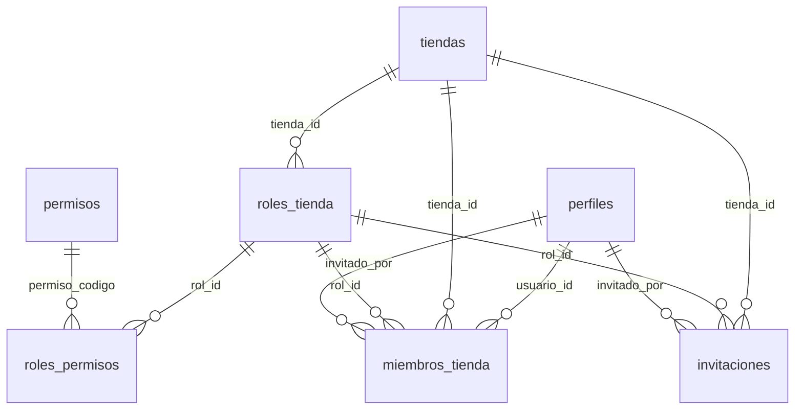

### `permisos`

Lista fija de permisos que se pueden dar a un empleado.

**3 campos** · RLS activo · 1 política

| # | Campo | Tipo | Longitud / precisión | Nulo | Por defecto | Clave | Referencia | Reglas | Descripción |
|---|---|---|---|---|---|---|---|---|---|
| 1 | `codigo` | `text` | Sin límite fijo | No |  | PK |  |  | Ej.: 'productos.editar' |
| 2 | `area` | `text` | Sin límite fijo | No |  |  |  |  | Área a la que pertenece el permiso (productos, pedidos, equipo, etc.) |
| 3 | `descripcion` | `text` | Sin límite fijo | No |  |  |  |  | Descripción |

Políticas RLS

| Política | Operación | Roles |
|---|---|---|
| permisos: lectura | SELECT | authenticated |

### `roles_tienda`

Roles: predefinidos (tienda_id vacío) o creados por cada tienda.

**5 campos** · RLS activo · 2 políticas · 2 triggers

| # | Campo | Tipo | Longitud / precisión | Nulo | Por defecto | Clave | Referencia | Reglas | Descripción |
|---|---|---|---|---|---|---|---|---|---|
| 1 | `id` | `uuid` | 16 bytes (36 caracteres en texto) | No | `gen_random_uuid()` | PK |  |  | Identificador único |
| 2 | `tienda_id` | `uuid` | 16 bytes (36 caracteres en texto) | Sí |  | FK | [tiendas.id (borra en cascada)](#tabla-tiendas) |  | Referencia a tiendas |
| 3 | `nombre` | `text` | Sin límite fijo | No |  |  |  |  | Nombre |
| 4 | `creado_en` | `timestamptz` | 8 bytes (fecha, hora y zona horaria; precisión de microsegundos) | No | `now()` |  |  |  | Fecha y hora de creación |
| 5 | `actualizado_en` | `timestamptz` | 8 bytes (fecha, hora y zona horaria; precisión de microsegundos) | No | `now()` |  |  |  | Última modificación (la actualiza un trigger) |

**Índices adicionales**

- `roles_tienda_nombre_unico` (único): `btree (COALESCE(tienda_id, '00000000-0000-0000-0000-000000000000'::uuid), lower(nombre))`
- `roles_tienda_tienda_id_idx`: `btree (tienda_id)`

**Triggers**

- `actualizado_en`: Antes de modificar → `tg_actualizado_en()`
- `auditar`: Después de insertar o borrar o modificar → `tg_auditar()`

Políticas RLS

| Política | Operación | Roles |
|---|---|---|
| roles_tienda: el superadmin define los predefinidos | ALL | authenticated |
| roles_tienda: ver predefinidos y los de mi tienda | SELECT | authenticated |

### `roles_permisos`

**2 campos** · RLS activo · 2 políticas · 1 trigger

| # | Campo | Tipo | Longitud / precisión | Nulo | Por defecto | Clave | Referencia | Reglas | Descripción |
|---|---|---|---|---|---|---|---|---|---|
| 1 | `rol_id` | `uuid` | 16 bytes (36 caracteres en texto) | No |  | PK (compuesta), FK | [roles_tienda.id (borra en cascada)](#tabla-roles_tienda) |  | Referencia a roles_tienda |
| 2 | `permiso_codigo` | `text` | Sin límite fijo | No |  | PK (compuesta), FK | [permisos.codigo (sin acción)](#tabla-permisos) |  | Referencia a permisos |

**Reglas de la tabla**

- Clave primaria compuesta: (rol_id, permiso_codigo)

**Índices adicionales**

- `roles_permisos_permiso_codigo_idx`: `btree (permiso_codigo)`

**Triggers**

- `auditar`: Después de insertar o borrar o modificar → `tg_auditar()`

Políticas RLS

| Política | Operación | Roles |
|---|---|---|
| roles_permisos: el superadmin edita los predefinidos | ALL | authenticated |
| roles_permisos: ver | SELECT | authenticated |

### `miembros_tienda`

**8 campos** · RLS activo · 3 políticas · 3 triggers

| # | Campo | Tipo | Longitud / precisión | Nulo | Por defecto | Clave | Referencia | Reglas | Descripción |
|---|---|---|---|---|---|---|---|---|---|
| 1 | `id` | `uuid` | 16 bytes (36 caracteres en texto) | No | `gen_random_uuid()` | PK |  |  | Identificador único |
| 2 | `tienda_id` | `uuid` | 16 bytes (36 caracteres en texto) | No |  | FK | [tiendas.id (borra en cascada)](#tabla-tiendas) |  | Referencia a tiendas |
| 3 | `usuario_id` | `uuid` | 16 bytes (36 caracteres en texto) | No |  | FK | [perfiles.id (borra en cascada)](#tabla-perfiles) |  | Referencia a perfiles |
| 4 | `rol_id` | `uuid` | 16 bytes (36 caracteres en texto) | No |  | FK | [roles_tienda.id (sin acción)](#tabla-roles_tienda) |  | Referencia a roles_tienda |
| 5 | `estado` | [enum estado_miembro](#enum-estado_miembro) | 4 bytes (lista cerrada de valores) | No | `'activo'` |  |  |  | Estado actual |
| 6 | `invitado_por` | `uuid` | 16 bytes (36 caracteres en texto) | Sí |  | FK | [perfiles.id (sin acción)](#tabla-perfiles) |  | Referencia a perfiles |
| 7 | `creado_en` | `timestamptz` | 8 bytes (fecha, hora y zona horaria; precisión de microsegundos) | No | `now()` |  |  |  | Fecha y hora de creación |
| 8 | `actualizado_en` | `timestamptz` | 8 bytes (fecha, hora y zona horaria; precisión de microsegundos) | No | `now()` |  |  |  | Última modificación (la actualiza un trigger) |

**Reglas de la tabla**

- Combinación única: (tienda_id, usuario_id)

**Índices adicionales**

- `miembros_tienda_invitado_por_idx`: `btree (invitado_por)`
- `miembros_tienda_rol_id_idx`: `btree (rol_id)`
- `miembros_tienda_usuario_id_idx`: `btree (usuario_id)`

**Triggers**

- `actualizado_en`: Antes de modificar → `tg_actualizado_en()`
- `auditar`: Después de insertar o borrar o modificar → `tg_auditar()`
- `miembros_control`: Antes de insertar o modificar → `tg_miembros_control()`

Políticas RLS

| Política | Operación | Roles |
|---|---|---|
| miembros: el dueño gestiona | UPDATE | authenticated |
| miembros: el dueño retira | DELETE | authenticated |
| miembros: ver | SELECT | authenticated |

### `invitaciones`

**10 campos** · RLS activo · 2 políticas · 1 trigger

| # | Campo | Tipo | Longitud / precisión | Nulo | Por defecto | Clave | Referencia | Reglas | Descripción |
|---|---|---|---|---|---|---|---|---|---|
| 1 | `id` | `uuid` | 16 bytes (36 caracteres en texto) | No | `gen_random_uuid()` | PK |  |  | Identificador único |
| 2 | `tienda_id` | `uuid` | 16 bytes (36 caracteres en texto) | No |  | FK | [tiendas.id (borra en cascada)](#tabla-tiendas) |  | Referencia a tiendas |
| 3 | `email` | `text` | Sin límite fijo | No |  |  |  |  | Correo electrónico |
| 4 | `rol_id` | `uuid` | 16 bytes (36 caracteres en texto) | No |  | FK | [roles_tienda.id (sin acción)](#tabla-roles_tienda) |  | Referencia a roles_tienda |
| 5 | `token_hash` | `text` | Sin límite fijo | No |  | Único |  |  | Se guarda el hash, nunca el token |
| 6 | `expira_en` | `timestamptz` | 8 bytes (fecha, hora y zona horaria; precisión de microsegundos) | No | `(now() + '7 days')` |  |  |  | Fecha y hora: expira |
| 7 | `estado` | [enum estado_invitacion](#enum-estado_invitacion) | 4 bytes (lista cerrada de valores) | No | `'pendiente'` |  |  |  | Estado actual |
| 8 | `invitado_por` | `uuid` | 16 bytes (36 caracteres en texto) | Sí |  | FK | [perfiles.id (sin acción)](#tabla-perfiles) |  | Referencia a perfiles |
| 9 | `creado_en` | `timestamptz` | 8 bytes (fecha, hora y zona horaria; precisión de microsegundos) | No | `now()` |  |  |  | Fecha y hora de creación |
| 10 | `actualizado_en` | `timestamptz` | 8 bytes (fecha, hora y zona horaria; precisión de microsegundos) | No | `now()` |  |  |  | Última modificación (la actualiza un trigger) |

**Índices adicionales**

- `invitaciones_invitado_por_idx`: `btree (invitado_por)`
- `invitaciones_rol_id_idx`: `btree (rol_id)`
- `invitaciones_tienda_id_idx`: `btree (tienda_id)`

**Triggers**

- `actualizado_en`: Antes de modificar → `tg_actualizado_en()`

Políticas RLS

| Política | Operación | Roles |
|---|---|---|
| invitaciones: el dueño anula | UPDATE | authenticated |
| invitaciones: el dueño ve y anula | SELECT | authenticated |

---

## Módulo 4 · Catálogo

Archivo: `supabase/migrations/20261001000400_catalogo.sql`

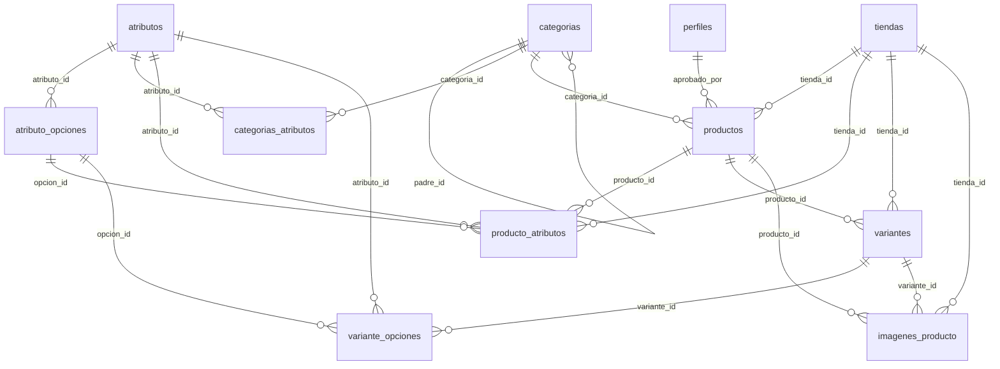

### `categorias`

Categorías en árbol, sin límite de niveles

**11 campos** · RLS activo · 2 políticas · 4 triggers

| # | Campo | Tipo | Longitud / precisión | Nulo | Por defecto | Clave | Referencia | Reglas | Descripción |
|---|---|---|---|---|---|---|---|---|---|
| 1 | `id` | `uuid` | 16 bytes (36 caracteres en texto) | No | `gen_random_uuid()` | PK |  |  | Identificador único |
| 2 | `padre_id` | `uuid` | 16 bytes (36 caracteres en texto) | Sí |  | FK | [categorias.id (sin acción)](#tabla-categorias) |  | Referencia a categorias |
| 3 | `nombre` | `text` | Sin límite fijo | No |  |  |  |  | Nombre |
| 4 | `slug` | `text` | Sin límite fijo | No |  |  |  |  | Identificador legible para URLs |
| 5 | `ruta` | `text` | Sin límite fijo | No | `''` |  |  |  | Ej.: /indumentaria/mujer/calzado/  (la calcula la base) |
| 6 | `orden` | `integer` | 4 bytes (±2.147.483.647) | No | `0` |  |  |  | Orden en que se muestra |
| 7 | `activa` | `boolean` | 1 byte (verdadero / falso) | No | `true` |  |  |  | Si está habilitada |
| 8 | `comision_pct` | `numeric(5,2)` | 5 dígitos, 2 decimales (máx. 999,99) | No | `0` |  |  | `(comision_pct >= 0) AND (comision_pct <= 100)` | Porcentaje de comisión que cobra la plataforma en esta categoría (0 a 100) |
| 9 | `creado_en` | `timestamptz` | 8 bytes (fecha, hora y zona horaria; precisión de microsegundos) | No | `now()` |  |  |  | Fecha y hora de creación |
| 10 | `actualizado_en` | `timestamptz` | 8 bytes (fecha, hora y zona horaria; precisión de microsegundos) | No | `now()` |  |  |  | Última modificación (la actualiza un trigger) |
| 11 | `requiere_revision` | `boolean` | 1 byte (verdadero / falso) | No | `false` |  |  |  | Indica si requiere revision |

**Reglas de la tabla**

- Regla: padre_id IS DISTINCT FROM id

**Índices adicionales**

- `categorias_padre_id_idx`: `btree (padre_id)`
- `categorias_ruta_prefijo`: `btree (ruta text_pattern_ops)`
- `categorias_ruta_unica` (único): `btree (ruta)`

**Triggers**

- `actualizado_en`: Antes de modificar → `tg_actualizado_en()`
- `auditar`: Después de insertar o borrar o modificar → `tg_auditar()`
- `categoria_ruta`: Antes de insertar o modificar padre_id, slug → `tg_categoria_ruta()`
- `categoria_ruta_hijas`: Después de modificar (si (old.ruta IS DISTINCT FROM new.ruta)) → `tg_categoria_ruta_hijas()`

Políticas RLS

| Política | Operación | Roles |
|---|---|---|
| categorias: lectura pública | SELECT | anon, authenticated |
| categorias: moderación edita | ALL | authenticated |

### `atributos`

**7 campos** · RLS activo · 2 políticas · 2 triggers

| # | Campo | Tipo | Longitud / precisión | Nulo | Por defecto | Clave | Referencia | Reglas | Descripción |
|---|---|---|---|---|---|---|---|---|---|
| 1 | `id` | `uuid` | 16 bytes (36 caracteres en texto) | No | `gen_random_uuid()` | PK |  |  | Identificador único |
| 2 | `nombre` | `text` | Sin límite fijo | No |  | Único |  |  | Nombre |
| 3 | `tipo` | [enum tipo_atributo](#enum-tipo_atributo) | 4 bytes (lista cerrada de valores) | No |  |  |  |  | Cómo se carga el valor: lista de opciones, texto, número o sí/no |
| 4 | `unidad` | `text` | Sin límite fijo | Sí |  |  |  |  | Ej.: 'GB', 'cm' |
| 5 | `filtrable` | `boolean` | 1 byte (verdadero / falso) | No | `false` |  |  |  | Indica si filtrable |
| 6 | `creado_en` | `timestamptz` | 8 bytes (fecha, hora y zona horaria; precisión de microsegundos) | No | `now()` |  |  |  | Fecha y hora de creación |
| 7 | `actualizado_en` | `timestamptz` | 8 bytes (fecha, hora y zona horaria; precisión de microsegundos) | No | `now()` |  |  |  | Última modificación (la actualiza un trigger) |

**Triggers**

- `actualizado_en`: Antes de modificar → `tg_actualizado_en()`
- `auditar`: Después de insertar o borrar o modificar → `tg_auditar()`

Políticas RLS

| Política | Operación | Roles |
|---|---|---|
| atributos: lectura pública | SELECT | anon, authenticated |
| atributos: moderación edita | ALL | authenticated |

### `atributo_opciones`

**4 campos** · RLS activo · 2 políticas · 1 trigger

| # | Campo | Tipo | Longitud / precisión | Nulo | Por defecto | Clave | Referencia | Reglas | Descripción |
|---|---|---|---|---|---|---|---|---|---|
| 1 | `id` | `uuid` | 16 bytes (36 caracteres en texto) | No | `gen_random_uuid()` | PK |  |  | Identificador único |
| 2 | `atributo_id` | `uuid` | 16 bytes (36 caracteres en texto) | No |  | FK | [atributos.id (borra en cascada)](#tabla-atributos) |  | Referencia a atributos |
| 3 | `valor` | `text` | Sin límite fijo | No |  |  |  |  | Ej.: 'M', 'Rojo' |
| 4 | `orden` | `integer` | 4 bytes (±2.147.483.647) | No | `0` |  |  |  | Orden en que se muestra |

**Reglas de la tabla**

- Combinación única: (atributo_id, valor)

**Triggers**

- `auditar`: Después de insertar o borrar o modificar → `tg_auditar()`

Políticas RLS

| Política | Operación | Roles |
|---|---|---|
| atributo_opciones: lectura pública | SELECT | anon, authenticated |
| atributo_opciones: moderación edita | ALL | authenticated |

### `categorias_atributos`

Qué atributos usa cada categoría. Las subcategorías heredan los de su padre.

**5 campos** · RLS activo · 2 políticas · 1 trigger

| # | Campo | Tipo | Longitud / precisión | Nulo | Por defecto | Clave | Referencia | Reglas | Descripción |
|---|---|---|---|---|---|---|---|---|---|
| 1 | `categoria_id` | `uuid` | 16 bytes (36 caracteres en texto) | No |  | PK (compuesta), FK | [categorias.id (borra en cascada)](#tabla-categorias) |  | Referencia a categorias |
| 2 | `atributo_id` | `uuid` | 16 bytes (36 caracteres en texto) | No |  | PK (compuesta), FK | [atributos.id (borra en cascada)](#tabla-atributos) |  | Referencia a atributos |
| 3 | `obligatorio` | `boolean` | 1 byte (verdadero / falso) | No | `false` |  |  |  | Indica si obligatorio |
| 4 | `define_variante` | `boolean` | 1 byte (verdadero / falso) | No | `false` |  |  |  | Talle y Color generan variantes |
| 5 | `orden` | `integer` | 4 bytes (±2.147.483.647) | No | `0` |  |  |  | Orden en que se muestra |

**Reglas de la tabla**

- Clave primaria compuesta: (categoria_id, atributo_id)

**Índices adicionales**

- `categorias_atributos_atributo_id_idx`: `btree (atributo_id)`

**Triggers**

- `auditar`: Después de insertar o borrar o modificar → `tg_auditar()`

Políticas RLS

| Política | Operación | Roles |
|---|---|---|
| categorias_atributos: lectura pública | SELECT | anon, authenticated |
| categorias_atributos: moderación edita | ALL | authenticated |

### `productos`

**17 campos** · RLS activo · 5 políticas · 6 triggers

| # | Campo | Tipo | Longitud / precisión | Nulo | Por defecto | Clave | Referencia | Reglas | Descripción |
|---|---|---|---|---|---|---|---|---|---|
| 1 | `id` | `uuid` | 16 bytes (36 caracteres en texto) | No | `gen_random_uuid()` | PK |  |  | Identificador único |
| 2 | `tienda_id` | `uuid` | 16 bytes (36 caracteres en texto) | No |  | FK | [tiendas.id (borra en cascada)](#tabla-tiendas) |  | Referencia a tiendas |
| 3 | `categoria_id` | `uuid` | 16 bytes (36 caracteres en texto) | No |  | FK | [categorias.id (sin acción)](#tabla-categorias) |  | Referencia a categorias |
| 4 | `nombre` | `text` | Sin límite fijo | No |  |  |  |  | Nombre |
| 5 | `slug` | `text` | Sin límite fijo | No |  |  |  |  | Identificador legible para URLs |
| 6 | `descripcion` | `text` | Sin límite fijo | Sí |  |  |  |  | Descripción |
| 7 | `estado` | [enum estado_producto](#enum-estado_producto) | 4 bytes (lista cerrada de valores) | No | `'borrador'` |  |  |  | Estado actual |
| 8 | `motivo_pausa` | [enum motivo_pausa](#enum-motivo_pausa) | 4 bytes (lista cerrada de valores) | Sí |  |  |  |  | Por qué está pausado: manual, por límite del plan o por moderación |
| 9 | `publicado_en` | `timestamptz` | 8 bytes (fecha, hora y zona horaria; precisión de microsegundos) | Sí |  |  |  |  | Fecha y hora: publicado |
| 10 | `texto_busqueda` | `tsvector` | Variable (índice de búsqueda de texto) | Sí |  |  |  |  | Lo calcula la base |
| 11 | `creado_en` | `timestamptz` | 8 bytes (fecha, hora y zona horaria; precisión de microsegundos) | No | `now()` |  |  |  | Fecha y hora de creación |
| 12 | `actualizado_en` | `timestamptz` | 8 bytes (fecha, hora y zona horaria; precisión de microsegundos) | No | `now()` |  |  |  | Última modificación (la actualiza un trigger) |
| 13 | `requiere_revision` | `boolean` | 1 byte (verdadero / falso) | No | `false` |  |  |  | Indica si requiere revision |
| 14 | `revision_desde` | `timestamptz` | 8 bytes (fecha, hora y zona horaria; precisión de microsegundos) | Sí |  |  |  |  |  |
| 15 | `nota_moderacion` | `text` | Sin límite fijo | Sí |  |  |  |  |  |
| 16 | `aprobado_en` | `timestamptz` | 8 bytes (fecha, hora y zona horaria; precisión de microsegundos) | Sí |  |  |  |  | Fecha y hora: aprobado |
| 17 | `aprobado_por` | `uuid` | 16 bytes (36 caracteres en texto) | Sí |  | FK | [perfiles.id (pone NULL)](#tabla-perfiles) |  | Referencia a perfiles |

**Reglas de la tabla**

- Combinación única: (tienda_id, slug)

**Índices adicionales**

- `productos_aprobado_por_idx`: `btree (aprobado_por)`
- `productos_aprobados_idx`: `btree (tienda_id) WHERE (aprobado_en IS NOT NULL)`
- `productos_busqueda`: `gin (texto_busqueda)`
- `productos_categoria_id_idx`: `btree (categoria_id) WHERE (estado = 'publicado'::estado_producto)`
- `productos_en_revision_idx`: `btree (revision_desde) WHERE (motivo_pausa = 'revision'::motivo_pausa)`
- `productos_nombre_trgm`: `gin (f_unaccent(lower(nombre)) extensions.gin_trgm_ops)`
- `productos_publicados_recientes_idx`: `btree (publicado_en DESC) WHERE (estado = 'publicado'::estado_producto)`
- `productos_publicados_tienda_idx`: `btree (tienda_id, publicado_en DESC) WHERE (estado = 'publicado'::estado_producto)`
- `productos_tienda_id_estado_idx`: `btree (tienda_id, estado)`

**Triggers**

- `actualizado_en`: Antes de modificar → `tg_actualizado_en()`
- `auditar`: Después de insertar o borrar o modificar → `tg_auditar()`
- `producto_categoria_final`: Antes de insertar o modificar categoria_id → `tg_producto_categoria_final()`
- `producto_texto_busqueda`: Antes de insertar o modificar nombre, descripcion → `tg_producto_texto_busqueda()`
- `productos_control`: Antes de insertar o modificar → `tg_productos_control()`
- `productos_revision`: Antes de insertar o modificar → `tg_productos_revision()`

Políticas RLS

| Política | Operación | Roles |
|---|---|---|
| productos: borrar con permiso | DELETE | authenticated |
| productos: crear con permiso | INSERT | authenticated |
| productos: editar con permiso | UPDATE | authenticated |
| productos: la tienda ve todos los suyos | SELECT | authenticated |
| productos: publicados de tiendas activas | SELECT | anon, authenticated |

### `producto_atributos`

Ficha técnica del producto (valores de atributos que no generan variantes).

**7 campos** · RLS activo · 3 políticas · 1 trigger

| # | Campo | Tipo | Longitud / precisión | Nulo | Por defecto | Clave | Referencia | Reglas | Descripción |
|---|---|---|---|---|---|---|---|---|---|
| 1 | `id` | `uuid` | 16 bytes (36 caracteres en texto) | No | `gen_random_uuid()` | PK |  |  | Identificador único |
| 2 | `producto_id` | `uuid` | 16 bytes (36 caracteres en texto) | No |  | FK | [productos.id (borra en cascada)](#tabla-productos) |  | Referencia a productos |
| 3 | `tienda_id` | `uuid` | 16 bytes (36 caracteres en texto) | No |  | FK | [tiendas.id (borra en cascada)](#tabla-tiendas) |  | Copia, la pone la base |
| 4 | `atributo_id` | `uuid` | 16 bytes (36 caracteres en texto) | No |  | FK | [atributos.id (sin acción)](#tabla-atributos) |  | Referencia a atributos |
| 5 | `valor_texto` | `text` | Sin límite fijo | Sí |  |  |  |  | Valor del atributo cuando es texto |
| 6 | `valor_numero` | `numeric` | Precisión libre | Sí |  |  |  |  | Valor del atributo cuando es número |
| 7 | `opcion_id` | `uuid` | 16 bytes (36 caracteres en texto) | Sí |  | FK | [atributo_opciones.id (sin acción)](#tabla-atributo_opciones) |  | Referencia a atributo_opciones |

**Reglas de la tabla**

- Combinación única: (producto_id, atributo_id)

**Índices adicionales**

- `producto_atributos_atributo_id_idx`: `btree (atributo_id)`
- `producto_atributos_opcion_id_idx`: `btree (opcion_id)`
- `producto_atributos_tienda_id_idx`: `btree (tienda_id)`

**Triggers**

- `heredar_tienda`: Antes de insertar o modificar producto_id, tienda_id → `tg_heredar_tienda_de_producto()`

Políticas RLS

| Política | Operación | Roles |
|---|---|---|
| producto_atributos: edita la tienda | ALL | authenticated |
| producto_atributos: lectura | SELECT | anon, authenticated |
| producto_atributos: moderación lee | SELECT | authenticated |

### `variantes`

Variantes: todo producto tiene al menos una. Un producto sin talles tiene una sola.

**10 campos** · RLS activo · 5 políticas · 4 triggers

| # | Campo | Tipo | Longitud / precisión | Nulo | Por defecto | Clave | Referencia | Reglas | Descripción |
|---|---|---|---|---|---|---|---|---|---|
| 1 | `id` | `uuid` | 16 bytes (36 caracteres en texto) | No | `gen_random_uuid()` | PK |  |  | Identificador único |
| 2 | `producto_id` | `uuid` | 16 bytes (36 caracteres en texto) | No |  | FK | [productos.id (borra en cascada)](#tabla-productos) |  | Referencia a productos |
| 3 | `tienda_id` | `uuid` | 16 bytes (36 caracteres en texto) | No |  | FK | [tiendas.id (borra en cascada)](#tabla-tiendas) |  | Copia, la pone la base |
| 4 | `sku` | `text` | Sin límite fijo | Sí |  |  |  |  | Código interno del comercio para la variante |
| 5 | `precio` | `numeric(12,2)` | 12 dígitos, 2 decimales (máx. 9.999.999.999,99) | No |  |  |  | `precio >= 0` | Precio en pesos |
| 6 | `precio_oferta` | `numeric(12,2)` | 12 dígitos, 2 decimales (máx. 9.999.999.999,99) | Sí |  |  |  | `precio_oferta >= 0` | Precio con descuento (debe ser menor al precio) |
| 7 | `stock` | `integer` | 4 bytes (±2.147.483.647) | No | `0` |  |  | `stock >= 0` | Unidades disponibles |
| 8 | `activa` | `boolean` | 1 byte (verdadero / falso) | No | `true` |  |  |  | Si está habilitada |
| 9 | `creado_en` | `timestamptz` | 8 bytes (fecha, hora y zona horaria; precisión de microsegundos) | No | `now()` |  |  |  | Fecha y hora de creación |
| 10 | `actualizado_en` | `timestamptz` | 8 bytes (fecha, hora y zona horaria; precisión de microsegundos) | No | `now()` |  |  |  | Última modificación (la actualiza un trigger) |

**Reglas de la tabla**

- Regla: (precio_oferta IS NULL) OR (precio_oferta < precio)

**Índices adicionales**

- `variantes_producto_id_idx`: `btree (producto_id)`
- `variantes_tienda_id_idx`: `btree (tienda_id)`

**Triggers**

- `actualizado_en`: Antes de modificar → `tg_actualizado_en()`
- `auditar`: Después de insertar o borrar o modificar → `tg_auditar()`
- `heredar_tienda`: Antes de insertar o modificar producto_id, tienda_id → `tg_heredar_tienda_de_producto()`
- `variantes_control`: Antes de modificar → `tg_variantes_control()`

Políticas RLS

| Política | Operación | Roles |
|---|---|---|
| variantes: borrar con productos.editar | DELETE | authenticated |
| variantes: crear y borrar con productos.editar | INSERT | authenticated |
| variantes: editar precio o stock | UPDATE | authenticated |
| variantes: lectura | SELECT | anon, authenticated |
| variantes: moderación lee | SELECT | authenticated |

### `variante_opciones`

Combinación de opciones de cada variante, ej.: Talle = M, Color = Rojo.

**3 campos** · RLS activo · 2 políticas

| # | Campo | Tipo | Longitud / precisión | Nulo | Por defecto | Clave | Referencia | Reglas | Descripción |
|---|---|---|---|---|---|---|---|---|---|
| 1 | `variante_id` | `uuid` | 16 bytes (36 caracteres en texto) | No |  | PK (compuesta), FK | [variantes.id (borra en cascada)](#tabla-variantes) |  | Referencia a variantes |
| 2 | `atributo_id` | `uuid` | 16 bytes (36 caracteres en texto) | No |  | PK (compuesta), FK | [atributos.id (sin acción)](#tabla-atributos) |  | Referencia a atributos |
| 3 | `opcion_id` | `uuid` | 16 bytes (36 caracteres en texto) | No |  | FK | [atributo_opciones.id (sin acción)](#tabla-atributo_opciones) |  | Referencia a atributo_opciones |

**Reglas de la tabla**

- Clave primaria compuesta: (variante_id, atributo_id)

**Índices adicionales**

- `variante_opciones_atributo_id_idx`: `btree (atributo_id)`
- `variante_opciones_opcion_id_idx`: `btree (opcion_id)`

Políticas RLS

| Política | Operación | Roles |
|---|---|---|
| variante_opciones: edita la tienda | ALL | authenticated |
| variante_opciones: lectura | SELECT | anon, authenticated |

### `imagenes_producto`

**8 campos** · RLS activo · 3 políticas · 1 trigger

| # | Campo | Tipo | Longitud / precisión | Nulo | Por defecto | Clave | Referencia | Reglas | Descripción |
|---|---|---|---|---|---|---|---|---|---|
| 1 | `id` | `uuid` | 16 bytes (36 caracteres en texto) | No | `gen_random_uuid()` | PK |  |  | Identificador único |
| 2 | `producto_id` | `uuid` | 16 bytes (36 caracteres en texto) | No |  | FK | [productos.id (borra en cascada)](#tabla-productos) |  | Referencia a productos |
| 3 | `tienda_id` | `uuid` | 16 bytes (36 caracteres en texto) | No |  | FK | [tiendas.id (borra en cascada)](#tabla-tiendas) |  | Copia, la pone la base |
| 4 | `variante_id` | `uuid` | 16 bytes (36 caracteres en texto) | Sí |  | FK | [variantes.id (pone NULL)](#tabla-variantes) |  | Foto de un color en particular |
| 5 | `ruta_storage` | `text` | Sin límite fijo | No |  |  |  |  | Ej.: tiendas/<tienda_id>/productos/<archivo>.webp |
| 6 | `orden` | `integer` | 4 bytes (±2.147.483.647) | No | `0` |  |  |  | Orden en que se muestra |
| 7 | `texto_alternativo` | `text` | Sin límite fijo | Sí |  |  |  |  | Descripción de la imagen para lectores de pantalla |
| 8 | `creado_en` | `timestamptz` | 8 bytes (fecha, hora y zona horaria; precisión de microsegundos) | No | `now()` |  |  |  | Fecha y hora de creación |

**Índices adicionales**

- `imagenes_producto_producto_id_orden_idx`: `btree (producto_id, orden)`
- `imagenes_producto_tienda_id_idx`: `btree (tienda_id)`
- `imagenes_producto_variante_id_idx`: `btree (variante_id)`

**Triggers**

- `heredar_tienda`: Antes de insertar o modificar producto_id, tienda_id → `tg_heredar_tienda_de_producto()`

Políticas RLS

| Política | Operación | Roles |
|---|---|---|
| imagenes: edita la tienda | ALL | authenticated |
| imagenes: lectura | SELECT | anon, authenticated |
| imagenes: moderación lee | SELECT | authenticated |

---

## Módulo 5 · Compras y pedidos

Archivo: `supabase/migrations/20261001000500_compras_pedidos.sql`

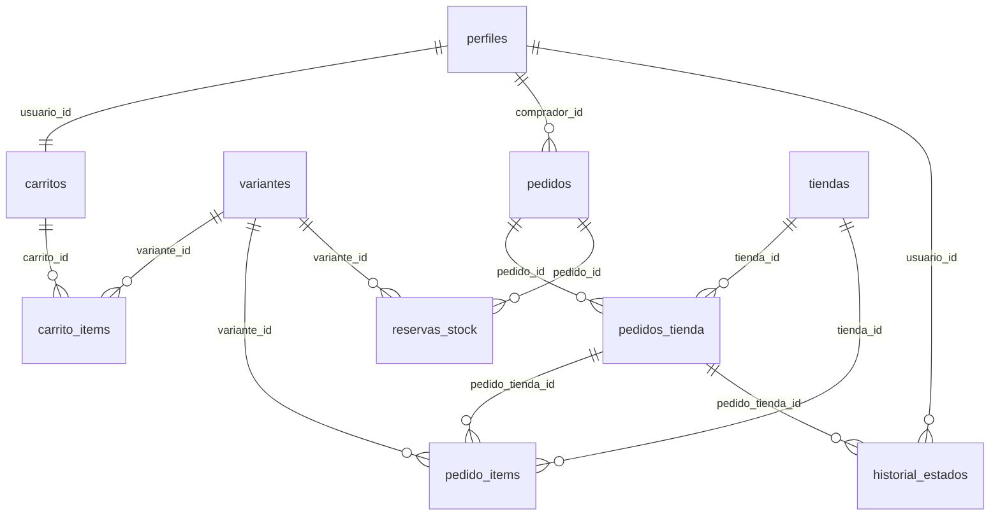

### `carritos`

Carrito: uno por usuario. Sin sesión, vive en el navegador y se une al entrar.

**4 campos** · RLS activo · 1 política · 1 trigger

| # | Campo | Tipo | Longitud / precisión | Nulo | Por defecto | Clave | Referencia | Reglas | Descripción |
|---|---|---|---|---|---|---|---|---|---|
| 1 | `id` | `uuid` | 16 bytes (36 caracteres en texto) | No | `gen_random_uuid()` | PK |  |  | Identificador único |
| 2 | `usuario_id` | `uuid` | 16 bytes (36 caracteres en texto) | No |  | FK, Único | [perfiles.id (borra en cascada)](#tabla-perfiles) |  | Referencia a perfiles |
| 3 | `creado_en` | `timestamptz` | 8 bytes (fecha, hora y zona horaria; precisión de microsegundos) | No | `now()` |  |  |  | Fecha y hora de creación |
| 4 | `actualizado_en` | `timestamptz` | 8 bytes (fecha, hora y zona horaria; precisión de microsegundos) | No | `now()` |  |  |  | Última modificación (la actualiza un trigger) |

**Triggers**

- `actualizado_en`: Antes de modificar → `tg_actualizado_en()`

Políticas RLS

| Política | Operación | Roles |
|---|---|---|
| carritos: el propio | ALL | authenticated |

### `carrito_items`

**6 campos** · RLS activo · 1 política · 1 trigger

| # | Campo | Tipo | Longitud / precisión | Nulo | Por defecto | Clave | Referencia | Reglas | Descripción |
|---|---|---|---|---|---|---|---|---|---|
| 1 | `id` | `uuid` | 16 bytes (36 caracteres en texto) | No | `gen_random_uuid()` | PK |  |  | Identificador único |
| 2 | `carrito_id` | `uuid` | 16 bytes (36 caracteres en texto) | No |  | FK | [carritos.id (borra en cascada)](#tabla-carritos) |  | Referencia a carritos |
| 3 | `variante_id` | `uuid` | 16 bytes (36 caracteres en texto) | No |  | FK | [variantes.id (borra en cascada)](#tabla-variantes) |  | Referencia a variantes |
| 4 | `cantidad` | `integer` | 4 bytes (±2.147.483.647) | No |  |  |  | `cantidad > 0` | Cantidad de unidades |
| 5 | `creado_en` | `timestamptz` | 8 bytes (fecha, hora y zona horaria; precisión de microsegundos) | No | `now()` |  |  |  | Fecha y hora de creación |
| 6 | `actualizado_en` | `timestamptz` | 8 bytes (fecha, hora y zona horaria; precisión de microsegundos) | No | `now()` |  |  |  | Última modificación (la actualiza un trigger) |

**Reglas de la tabla**

- Combinación única: (carrito_id, variante_id)

**Índices adicionales**

- `carrito_items_variante_id_idx`: `btree (variante_id)`

**Triggers**

- `actualizado_en`: Antes de modificar → `tg_actualizado_en()`

Políticas RLS

| Política | Operación | Roles |
|---|---|---|
| carrito_items: los propios | ALL | authenticated |

### `pedidos`

**10 campos** · RLS activo · 1 política · 1 trigger

| # | Campo | Tipo | Longitud / precisión | Nulo | Por defecto | Clave | Referencia | Reglas | Descripción |
|---|---|---|---|---|---|---|---|---|---|
| 1 | `id` | `uuid` | 16 bytes (36 caracteres en texto) | No | `gen_random_uuid()` | PK |  |  | Identificador único |
| 2 | `numero` | `bigint` | 8 bytes (±9,22 × 10¹⁸) | No | `nextval('pedidos_numero_seq')` | Único |  |  | Número de pedido visible para el cliente (empieza en 1000) |
| 3 | `comprador_id` | `uuid` | 16 bytes (36 caracteres en texto) | No |  | FK | [perfiles.id (sin acción)](#tabla-perfiles) |  | Referencia a perfiles |
| 4 | `subtotal` | `numeric(12,2)` | 12 dígitos, 2 decimales (máx. 9.999.999.999,99) | No | `0` |  |  |  | Importe sin envío en pesos |
| 5 | `costo_envio` | `numeric(12,2)` | 12 dígitos, 2 decimales (máx. 9.999.999.999,99) | No | `0` |  |  |  | Lo cobra la plataforma |
| 6 | `total` | `numeric(12,2)` | 12 dígitos, 2 decimales (máx. 9.999.999.999,99) | No | `0` |  |  |  | Importe total en pesos |
| 7 | `estado_pago` | [enum estado_pago_pedido](#enum-estado_pago_pedido) | 4 bytes (lista cerrada de valores) | No | `'pendiente'` |  |  |  | Estado del pago de la compra completa |
| 8 | `direccion_envio` | `jsonb` | Variable (JSON binario) | Sí |  |  |  |  | Copia de la dirección al comprar |
| 9 | `creado_en` | `timestamptz` | 8 bytes (fecha, hora y zona horaria; precisión de microsegundos) | No | `now()` |  |  |  | Fecha y hora de creación |
| 10 | `actualizado_en` | `timestamptz` | 8 bytes (fecha, hora y zona horaria; precisión de microsegundos) | No | `now()` |  |  |  | Última modificación (la actualiza un trigger) |

**Índices adicionales**

- `pedidos_comprador_estado_pago_idx`: `btree (comprador_id, estado_pago)`
- `pedidos_comprador_id_creado_en_idx`: `btree (comprador_id, creado_en DESC)`
- `pedidos_creado_en_idx`: `btree (creado_en DESC)`

**Triggers**

- `actualizado_en`: Antes de modificar → `tg_actualizado_en()`

Políticas RLS

| Política | Operación | Roles |
|---|---|---|
| pedidos: comprador, comercio, repartidor y admin | SELECT | authenticated |

### `pedidos_tienda`

**12 campos** · RLS activo · 2 políticas · 3 triggers

| # | Campo | Tipo | Longitud / precisión | Nulo | Por defecto | Clave | Referencia | Reglas | Descripción |
|---|---|---|---|---|---|---|---|---|---|
| 1 | `id` | `uuid` | 16 bytes (36 caracteres en texto) | No | `gen_random_uuid()` | PK |  |  | Identificador único |
| 2 | `pedido_id` | `uuid` | 16 bytes (36 caracteres en texto) | No |  | FK | [pedidos.id (borra en cascada)](#tabla-pedidos) |  | Referencia a pedidos |
| 3 | `tienda_id` | `uuid` | 16 bytes (36 caracteres en texto) | No |  | FK | [tiendas.id (sin acción)](#tabla-tiendas) |  | Referencia a tiendas |
| 4 | `modalidad` | [enum modalidad_entrega](#enum-modalidad_entrega) | 4 bytes (lista cerrada de valores) | No | `'entrega_plataforma'` |  |  |  | Entrega a domicilio por la plataforma o retiro en el local |
| 5 | `subtotal` | `numeric(12,2)` | 12 dígitos, 2 decimales (máx. 9.999.999.999,99) | No | `0` |  |  |  | Importe sin envío en pesos |
| 6 | `comision` | `numeric(12,2)` | 12 dígitos, 2 decimales (máx. 9.999.999.999,99) | No | `0` |  |  |  | Comisión de la plataforma sobre esta parte, en pesos |
| 7 | `total` | `numeric(12,2)` | 12 dígitos, 2 decimales (máx. 9.999.999.999,99) | No | `0` |  |  |  | Importe total en pesos |
| 8 | `estado` | [enum estado_pedido_tienda](#enum-estado_pedido_tienda) | 4 bytes (lista cerrada de valores) | No | `'pendiente'` |  |  |  | Estado actual |
| 9 | `listo_en` | `timestamptz` | 8 bytes (fecha, hora y zona horaria; precisión de microsegundos) | Sí |  |  |  |  | Fecha y hora: listo |
| 10 | `motivo_cancelacion` | `text` | Sin límite fijo | Sí |  |  |  |  | Motivo de la cancelación, si se canceló |
| 11 | `creado_en` | `timestamptz` | 8 bytes (fecha, hora y zona horaria; precisión de microsegundos) | No | `now()` |  |  |  | Fecha y hora de creación |
| 12 | `actualizado_en` | `timestamptz` | 8 bytes (fecha, hora y zona horaria; precisión de microsegundos) | No | `now()` |  |  |  | Última modificación (la actualiza un trigger) |

**Reglas de la tabla**

- Combinación única: (pedido_id, tienda_id)

**Índices adicionales**

- `pedidos_tienda_tienda_id_estado_creado_en_idx`: `btree (tienda_id, estado, creado_en DESC)`

**Triggers**

- `actualizado_en`: Antes de modificar → `tg_actualizado_en()`
- `pedidos_tienda_control`: Antes de modificar → `tg_pedidos_tienda_control()`
- `pedidos_tienda_efectos`: Después de modificar estado (si (old.estado IS DISTINCT FROM new.estado)) → `tg_pedidos_tienda_efectos()`

Políticas RLS

| Política | Operación | Roles |
|---|---|---|
| pedidos_tienda: el comercio gestiona su parte | UPDATE | authenticated |
| pedidos_tienda: ver | SELECT | authenticated |

### `pedido_items`

Productos comprados. Guarda copia de nombre y precio: si el producto cambia o se borra después, el pedido no cambia.

**10 campos** · RLS activo · 1 política

| # | Campo | Tipo | Longitud / precisión | Nulo | Por defecto | Clave | Referencia | Reglas | Descripción |
|---|---|---|---|---|---|---|---|---|---|
| 1 | `id` | `uuid` | 16 bytes (36 caracteres en texto) | No | `gen_random_uuid()` | PK |  |  | Identificador único |
| 2 | `pedido_tienda_id` | `uuid` | 16 bytes (36 caracteres en texto) | No |  | FK | [pedidos_tienda.id (borra en cascada)](#tabla-pedidos_tienda) |  | Referencia a pedidos_tienda |
| 3 | `tienda_id` | `uuid` | 16 bytes (36 caracteres en texto) | No |  | FK | [tiendas.id (sin acción)](#tabla-tiendas) |  | Referencia a tiendas |
| 4 | `variante_id` | `uuid` | 16 bytes (36 caracteres en texto) | Sí |  | FK | [variantes.id (pone NULL)](#tabla-variantes) |  | Referencia a variantes |
| 5 | `nombre_producto` | `text` | Sin límite fijo | No |  |  |  |  | Nombre del producto al momento de comprar (copia congelada) |
| 6 | `descripcion_variante` | `text` | Sin límite fijo | Sí |  |  |  |  | Variante elegida al comprar (ej.: "Talle M, Rojo") |
| 7 | `precio_unitario` | `numeric(12,2)` | 12 dígitos, 2 decimales (máx. 9.999.999.999,99) | No |  |  |  | `precio_unitario >= 0` | Precio por unidad al momento de comprar (copia congelada) |
| 8 | `cantidad` | `integer` | 4 bytes (±2.147.483.647) | No |  |  |  | `cantidad > 0` | Cantidad de unidades |
| 9 | `subtotal` | `numeric(12,2)` | 12 dígitos, 2 decimales (máx. 9.999.999.999,99) | No |  |  |  |  | Importe sin envío en pesos |
| 10 | `creado_en` | `timestamptz` | 8 bytes (fecha, hora y zona horaria; precisión de microsegundos) | No | `now()` |  |  |  | Fecha y hora de creación |

**Índices adicionales**

- `pedido_items_creado_en_idx`: `btree (creado_en DESC) INCLUDE (variante_id, cantidad, pedido_tienda_id)`
- `pedido_items_pedido_tienda_id_idx`: `btree (pedido_tienda_id)`
- `pedido_items_tienda_id_idx`: `btree (tienda_id)`
- `pedido_items_variante_id_idx`: `btree (variante_id)`

Políticas RLS

| Política | Operación | Roles |
|---|---|---|
| pedido_items: ver | SELECT | authenticated |

### `reservas_stock`

Reserva temporal de stock mientras el cliente paga (vence a los 15 minutos)

**6 campos** · RLS activo

| # | Campo | Tipo | Longitud / precisión | Nulo | Por defecto | Clave | Referencia | Reglas | Descripción |
|---|---|---|---|---|---|---|---|---|---|
| 1 | `id` | `uuid` | 16 bytes (36 caracteres en texto) | No | `gen_random_uuid()` | PK |  |  | Identificador único |
| 2 | `variante_id` | `uuid` | 16 bytes (36 caracteres en texto) | No |  | FK | [variantes.id (borra en cascada)](#tabla-variantes) |  | Referencia a variantes |
| 3 | `pedido_id` | `uuid` | 16 bytes (36 caracteres en texto) | No |  | FK | [pedidos.id (borra en cascada)](#tabla-pedidos) |  | Referencia a pedidos |
| 4 | `cantidad` | `integer` | 4 bytes (±2.147.483.647) | No |  |  |  | `cantidad > 0` | Cantidad de unidades |
| 5 | `expira_en` | `timestamptz` | 8 bytes (fecha, hora y zona horaria; precisión de microsegundos) | No |  |  |  |  | Fecha y hora: expira |
| 6 | `creado_en` | `timestamptz` | 8 bytes (fecha, hora y zona horaria; precisión de microsegundos) | No | `now()` |  |  |  | Fecha y hora de creación |

**Índices adicionales**

- `reservas_stock_pedido_id_idx`: `btree (pedido_id)`
- `reservas_stock_variante_id_expira_en_idx`: `btree (variante_id, expira_en)`

### `historial_estados`

Historial: quién cambió cada estado y cuándo (lo llena la base sola)

**7 campos** · RLS activo · 1 política

| # | Campo | Tipo | Longitud / precisión | Nulo | Por defecto | Clave | Referencia | Reglas | Descripción |
|---|---|---|---|---|---|---|---|---|---|
| 1 | `id` | `uuid` | 16 bytes (36 caracteres en texto) | No | `gen_random_uuid()` | PK |  |  | Identificador único |
| 2 | `pedido_tienda_id` | `uuid` | 16 bytes (36 caracteres en texto) | No |  | FK | [pedidos_tienda.id (borra en cascada)](#tabla-pedidos_tienda) |  | Referencia a pedidos_tienda |
| 3 | `estado_anterior` | [enum estado_pedido_tienda](#enum-estado_pedido_tienda) | 4 bytes (lista cerrada de valores) | Sí |  |  |  |  | Estado antes del cambio |
| 4 | `estado_nuevo` | [enum estado_pedido_tienda](#enum-estado_pedido_tienda) | 4 bytes (lista cerrada de valores) | No |  |  |  |  | Estado después del cambio |
| 5 | `usuario_id` | `uuid` | 16 bytes (36 caracteres en texto) | Sí |  | FK | [perfiles.id (sin acción)](#tabla-perfiles) |  | Referencia a perfiles |
| 6 | `nota` | `text` | Sin límite fijo | Sí |  |  |  |  | Comentario sobre el cambio |
| 7 | `creado_en` | `timestamptz` | 8 bytes (fecha, hora y zona horaria; precisión de microsegundos) | No | `now()` |  |  |  | Fecha y hora de creación |

**Índices adicionales**

- `historial_estados_pedido_tienda_id_creado_en_idx`: `btree (pedido_tienda_id, creado_en)`
- `historial_estados_usuario_id_idx`: `btree (usuario_id)`

Políticas RLS

| Política | Operación | Roles |
|---|---|---|
| historial_estados: ver | SELECT | authenticated |

---

## Módulo 6 · Pagos de ventas (Mercado Pago)

Archivo: `supabase/migrations/20261001000600_pagos_ventas.sql`

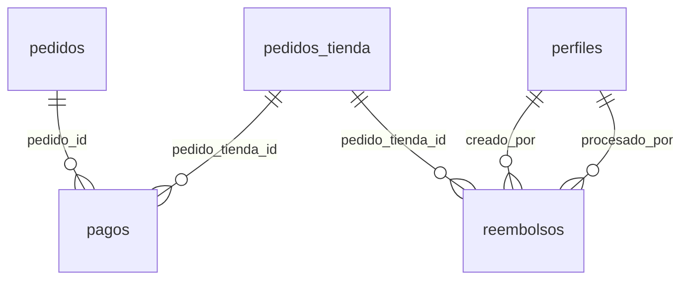

### `pagos`

**10 campos** · RLS activo · 1 política · 1 trigger

| # | Campo | Tipo | Longitud / precisión | Nulo | Por defecto | Clave | Referencia | Reglas | Descripción |
|---|---|---|---|---|---|---|---|---|---|
| 1 | `id` | `uuid` | 16 bytes (36 caracteres en texto) | No | `gen_random_uuid()` | PK |  |  | Identificador único |
| 2 | `pedido_id` | `uuid` | 16 bytes (36 caracteres en texto) | No |  | FK | [pedidos.id (borra en cascada)](#tabla-pedidos) |  | Referencia a pedidos |
| 3 | `pedido_tienda_id` | `uuid` | 16 bytes (36 caracteres en texto) | Sí |  | FK | [pedidos_tienda.id (sin acción)](#tabla-pedidos_tienda) |  | Solo si Mercado Pago no habilita el pago 1:N (plan B) |
| 4 | `mp_payment_id` | `text` | Sin límite fijo | Sí |  | Único |  |  | Id del pago en Mercado Pago (evita cobrar dos veces el mismo aviso) |
| 5 | `monto` | `numeric(12,2)` | 12 dígitos, 2 decimales (máx. 9.999.999.999,99) | No |  |  |  | `monto >= 0` | Importe en pesos |
| 6 | `comision_marketplace` | `numeric(12,2)` | 12 dígitos, 2 decimales (máx. 9.999.999.999,99) | No | `0` |  |  |  | Comisión total de la plataforma en este pago, en pesos |
| 7 | `estado` | [enum estado_pago](#enum-estado_pago) | 4 bytes (lista cerrada de valores) | No | `'pendiente'` |  |  |  | Estado actual |
| 8 | `respuesta_mp` | `jsonb` | Variable (JSON binario) | Sí |  |  |  |  | Respuesta completa del aviso (webhook) de Mercado Pago |
| 9 | `creado_en` | `timestamptz` | 8 bytes (fecha, hora y zona horaria; precisión de microsegundos) | No | `now()` |  |  |  | Fecha y hora de creación |
| 10 | `actualizado_en` | `timestamptz` | 8 bytes (fecha, hora y zona horaria; precisión de microsegundos) | No | `now()` |  |  |  | Última modificación (la actualiza un trigger) |

**Índices adicionales**

- `pagos_pedido_id_idx`: `btree (pedido_id)`
- `pagos_pedido_tienda_id_idx`: `btree (pedido_tienda_id)`

**Triggers**

- `actualizado_en`: Antes de modificar → `tg_actualizado_en()`

Políticas RLS

| Política | Operación | Roles |
|---|---|---|
| pagos: solo finanzas | SELECT | authenticated |

### `reembolsos`

Permite devolver solo la parte de una tienda.

**13 campos** · RLS activo · 3 políticas · 4 triggers

| # | Campo | Tipo | Longitud / precisión | Nulo | Por defecto | Clave | Referencia | Reglas | Descripción |
|---|---|---|---|---|---|---|---|---|---|
| 1 | `id` | `uuid` | 16 bytes (36 caracteres en texto) | No | `gen_random_uuid()` | PK |  |  | Identificador único |
| 2 | `pedido_tienda_id` | `uuid` | 16 bytes (36 caracteres en texto) | No |  | FK | [pedidos_tienda.id (borra en cascada)](#tabla-pedidos_tienda) |  | Referencia a pedidos_tienda |
| 3 | `monto` | `numeric(12,2)` | 12 dígitos, 2 decimales (máx. 9.999.999.999,99) | No |  |  |  | `monto > 0` | Importe en pesos |
| 4 | `motivo` | `text` | Sin límite fijo | No |  |  |  |  | Motivo |
| 5 | `mp_refund_id` | `text` | Sin límite fijo | Sí |  | Único |  |  | Id de la devolución en Mercado Pago |
| 6 | `estado` | [enum estado_reembolso](#enum-estado_reembolso) | 4 bytes (lista cerrada de valores) | No | `'pendiente'` |  |  |  | Estado actual |
| 7 | `creado_en` | `timestamptz` | 8 bytes (fecha, hora y zona horaria; precisión de microsegundos) | No | `now()` |  |  |  | Fecha y hora de creación |
| 8 | `actualizado_en` | `timestamptz` | 8 bytes (fecha, hora y zona horaria; precisión de microsegundos) | No | `now()` |  |  |  | Última modificación (la actualiza un trigger) |
| 9 | `es_envio` | `boolean` | 1 byte (verdadero / falso) | No | `false` |  |  |  | Indica si es envio |
| 10 | `nota` | `text` | Hasta 500 caracteres | Sí |  |  |  |  |  |
| 11 | `creado_por` | `uuid` | 16 bytes (36 caracteres en texto) | Sí |  | FK | [perfiles.id (pone NULL)](#tabla-perfiles) |  | Referencia a perfiles |
| 12 | `procesado_por` | `uuid` | 16 bytes (36 caracteres en texto) | Sí |  | FK | [perfiles.id (pone NULL)](#tabla-perfiles) |  | Referencia a perfiles |
| 13 | `procesado_en` | `timestamptz` | 8 bytes (fecha, hora y zona horaria; precisión de microsegundos) | Sí |  |  |  |  | Fecha y hora: procesado |

**Índices adicionales**

- `reembolsos_creado_por_idx`: `btree (creado_por)`
- `reembolsos_pedido_tienda_id_idx`: `btree (pedido_tienda_id)`
- `reembolsos_pendientes_idx`: `btree (creado_en) WHERE (estado = 'pendiente'::estado_reembolso)`
- `reembolsos_procesado_por_idx`: `btree (procesado_por)`

**Triggers**

- `actualizado_en`: Antes de modificar → `tg_actualizado_en()`
- `auditar`: Después de insertar o borrar o modificar → `tg_auditar()`
- `reembolsos_control`: Antes de insertar o modificar → `tg_reembolsos_control()`
- `reembolsos_efectos`: Después de modificar estado (si ((new.estado = 'procesado'::estado_reembolso) AND (old.estado <> 'procesado'::estado_reembolso))) → `tg_reembolsos_efectos()`

Políticas RLS

| Política | Operación | Roles |
|---|---|---|
| reembolsos: comprador, comercio con ventas.ver y finanzas | SELECT | authenticated |
| reembolsos: finanzas crea | INSERT | authenticated |
| reembolsos: finanzas procesa | UPDATE | authenticated |

---

## Módulo 7 · Logística (a cargo de la plataforma)

Archivo: `supabase/migrations/20261001000700_logistica.sql`

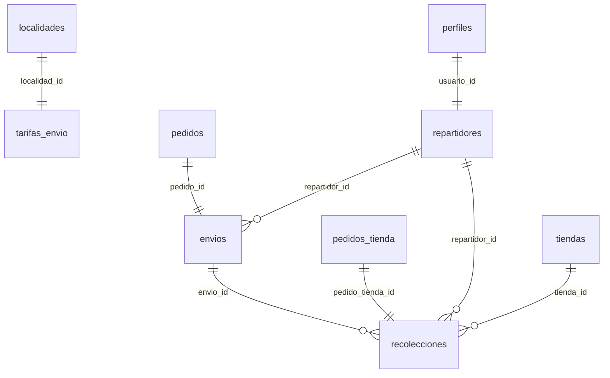

### `tarifas_envio`

Se entrega todo junto en una sola visita, con repartidores propios. Costo de envío por localidad. Lo fija el dueño de la plataforma; no hay envío gratis.

**6 campos** · RLS activo · 2 políticas · 2 triggers

| # | Campo | Tipo | Longitud / precisión | Nulo | Por defecto | Clave | Referencia | Reglas | Descripción |
|---|---|---|---|---|---|---|---|---|---|
| 1 | `id` | `uuid` | 16 bytes (36 caracteres en texto) | No | `gen_random_uuid()` | PK |  |  | Identificador único |
| 2 | `localidad_id` | `uuid` | 16 bytes (36 caracteres en texto) | No |  | FK, Único | [localidades.id (sin acción)](#tabla-localidades) |  | Referencia a localidades |
| 3 | `costo` | `numeric(12,2)` | 12 dígitos, 2 decimales (máx. 9.999.999.999,99) | No |  |  |  | `costo >= 0` | Costo de envío a la localidad, en pesos |
| 4 | `activa` | `boolean` | 1 byte (verdadero / falso) | No | `true` |  |  |  | Si está habilitada |
| 5 | `creado_en` | `timestamptz` | 8 bytes (fecha, hora y zona horaria; precisión de microsegundos) | No | `now()` |  |  |  | Fecha y hora de creación |
| 6 | `actualizado_en` | `timestamptz` | 8 bytes (fecha, hora y zona horaria; precisión de microsegundos) | No | `now()` |  |  |  | Última modificación (la actualiza un trigger) |

**Triggers**

- `actualizado_en`: Antes de modificar → `tg_actualizado_en()`
- `auditar`: Después de insertar o borrar o modificar → `tg_auditar()`

Políticas RLS

| Política | Operación | Roles |
|---|---|---|
| tarifas: lectura pública | SELECT | anon, authenticated |
| tarifas: logística edita | ALL | authenticated |

### `repartidores`

**8 campos** · RLS activo · 2 políticas · 2 triggers

| # | Campo | Tipo | Longitud / precisión | Nulo | Por defecto | Clave | Referencia | Reglas | Descripción |
|---|---|---|---|---|---|---|---|---|---|
| 1 | `id` | `uuid` | 16 bytes (36 caracteres en texto) | No | `gen_random_uuid()` | PK |  |  | Identificador único |
| 2 | `usuario_id` | `uuid` | 16 bytes (36 caracteres en texto) | No |  | FK, Único | [perfiles.id (sin acción)](#tabla-perfiles) |  | Referencia a perfiles |
| 3 | `nombre` | `text` | Sin límite fijo | No |  |  |  |  | Nombre |
| 4 | `telefono` | `text` | Sin límite fijo | No |  |  |  |  | Teléfono |
| 5 | `vehiculo` | `text` | Sin límite fijo | Sí |  |  |  |  | Vehículo que usa (moto, bici, auto) |
| 6 | `activo` | `boolean` | 1 byte (verdadero / falso) | No | `true` |  |  |  | Si está habilitado |
| 7 | `creado_en` | `timestamptz` | 8 bytes (fecha, hora y zona horaria; precisión de microsegundos) | No | `now()` |  |  |  | Fecha y hora de creación |
| 8 | `actualizado_en` | `timestamptz` | 8 bytes (fecha, hora y zona horaria; precisión de microsegundos) | No | `now()` |  |  |  | Última modificación (la actualiza un trigger) |

**Triggers**

- `actualizado_en`: Antes de modificar → `tg_actualizado_en()`
- `auditar`: Después de insertar o borrar o modificar → `tg_auditar()`

Políticas RLS

| Política | Operación | Roles |
|---|---|---|
| repartidores: el propio y logística | SELECT | authenticated |
| repartidores: logística edita | ALL | authenticated |

### `envios`

**10 campos** · RLS activo · 2 políticas · 3 triggers

| # | Campo | Tipo | Longitud / precisión | Nulo | Por defecto | Clave | Referencia | Reglas | Descripción |
|---|---|---|---|---|---|---|---|---|---|
| 1 | `id` | `uuid` | 16 bytes (36 caracteres en texto) | No | `gen_random_uuid()` | PK |  |  | Identificador único |
| 2 | `pedido_id` | `uuid` | 16 bytes (36 caracteres en texto) | No |  | FK, Único | [pedidos.id (borra en cascada)](#tabla-pedidos) |  | Referencia a pedidos |
| 3 | `repartidor_id` | `uuid` | 16 bytes (36 caracteres en texto) | Sí |  | FK | [repartidores.id (sin acción)](#tabla-repartidores) |  | Referencia a repartidores |
| 4 | `direccion_destino` | `jsonb` | Variable (JSON binario) | No |  |  |  |  | Copia de la dirección |
| 5 | `costo` | `numeric(12,2)` | 12 dígitos, 2 decimales (máx. 9.999.999.999,99) | No | `0` |  |  |  | Costo de envío cobrado al cliente, en pesos |
| 6 | `estado` | [enum estado_envio](#enum-estado_envio) | 4 bytes (lista cerrada de valores) | No | `'pendiente'` |  |  |  | Estado actual |
| 7 | `entregado_en` | `timestamptz` | 8 bytes (fecha, hora y zona horaria; precisión de microsegundos) | Sí |  |  |  |  | Fecha y hora: entregado |
| 8 | `comprobante_entrega` | `text` | Sin límite fijo | Sí |  |  |  |  | Foto o firma en Storage |
| 9 | `creado_en` | `timestamptz` | 8 bytes (fecha, hora y zona horaria; precisión de microsegundos) | No | `now()` |  |  |  | Fecha y hora de creación |
| 10 | `actualizado_en` | `timestamptz` | 8 bytes (fecha, hora y zona horaria; precisión de microsegundos) | No | `now()` |  |  |  | Última modificación (la actualiza un trigger) |

**Índices adicionales**

- `envios_repartidor_id_estado_idx`: `btree (repartidor_id, estado)`

**Triggers**

- `actualizado_en`: Antes de modificar → `tg_actualizado_en()`
- `envios_control`: Antes de modificar → `tg_envios_control()`
- `envios_efectos`: Después de modificar → `tg_envios_efectos()`

Políticas RLS

| Política | Operación | Roles |
|---|---|---|
| envios: comprador, repartidor y logística | SELECT | authenticated |
| envios: repartidor marca entrega, logística asigna | UPDATE | authenticated |

### `recolecciones`

**10 campos** · RLS activo · 2 políticas · 3 triggers

| # | Campo | Tipo | Longitud / precisión | Nulo | Por defecto | Clave | Referencia | Reglas | Descripción |
|---|---|---|---|---|---|---|---|---|---|
| 1 | `id` | `uuid` | 16 bytes (36 caracteres en texto) | No | `gen_random_uuid()` | PK |  |  | Identificador único |
| 2 | `envio_id` | `uuid` | 16 bytes (36 caracteres en texto) | No |  | FK | [envios.id (borra en cascada)](#tabla-envios) |  | Referencia a envios |
| 3 | `pedido_tienda_id` | `uuid` | 16 bytes (36 caracteres en texto) | No |  | FK, Único | [pedidos_tienda.id (borra en cascada)](#tabla-pedidos_tienda) |  | Referencia a pedidos_tienda |
| 4 | `tienda_id` | `uuid` | 16 bytes (36 caracteres en texto) | No |  | FK | [tiendas.id (sin acción)](#tabla-tiendas) |  | Referencia a tiendas |
| 5 | `repartidor_id` | `uuid` | 16 bytes (36 caracteres en texto) | Sí |  | FK | [repartidores.id (sin acción)](#tabla-repartidores) |  | Referencia a repartidores |
| 6 | `estado` | [enum estado_recoleccion](#enum-estado_recoleccion) | 4 bytes (lista cerrada de valores) | No | `'pendiente'` |  |  |  | Estado actual |
| 7 | `llegada_en` | `timestamptz` | 8 bytes (fecha, hora y zona horaria; precisión de microsegundos) | Sí |  |  |  |  | Fecha y hora: llegada |
| 8 | `recolectado_en` | `timestamptz` | 8 bytes (fecha, hora y zona horaria; precisión de microsegundos) | Sí |  |  |  |  | Fecha y hora: recolectado |
| 9 | `creado_en` | `timestamptz` | 8 bytes (fecha, hora y zona horaria; precisión de microsegundos) | No | `now()` |  |  |  | Fecha y hora de creación |
| 10 | `actualizado_en` | `timestamptz` | 8 bytes (fecha, hora y zona horaria; precisión de microsegundos) | No | `now()` |  |  |  | Última modificación (la actualiza un trigger) |

**Índices adicionales**

- `recolecciones_envio_id_idx`: `btree (envio_id)`
- `recolecciones_repartidor_id_estado_idx`: `btree (repartidor_id, estado)`
- `recolecciones_tienda_id_estado_idx`: `btree (tienda_id, estado)`

**Triggers**

- `actualizado_en`: Antes de modificar → `tg_actualizado_en()`
- `recolecciones_control`: Antes de modificar → `tg_recolecciones_control()`
- `recolecciones_efectos`: Después de modificar estado → `tg_recolecciones_efectos()`

Políticas RLS

| Política | Operación | Roles |
|---|---|---|
| recolecciones: repartidor y logística actualizan | UPDATE | authenticated |
| recolecciones: repartidor, comercio y logística | SELECT | authenticated |

---

## Módulo 8 · Comunicación

Archivo: `supabase/migrations/20261001000800_comunicacion.sql`

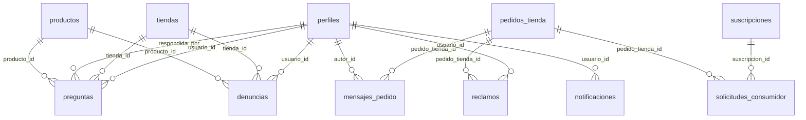

### `preguntas`

Preguntas públicas en la publicación, como en Mercado Libre.

**11 campos** · RLS activo · 4 políticas · 3 triggers

| # | Campo | Tipo | Longitud / precisión | Nulo | Por defecto | Clave | Referencia | Reglas | Descripción |
|---|---|---|---|---|---|---|---|---|---|
| 1 | `id` | `uuid` | 16 bytes (36 caracteres en texto) | No | `gen_random_uuid()` | PK |  |  | Identificador único |
| 2 | `producto_id` | `uuid` | 16 bytes (36 caracteres en texto) | No |  | FK | [productos.id (borra en cascada)](#tabla-productos) |  | Referencia a productos |
| 3 | `tienda_id` | `uuid` | 16 bytes (36 caracteres en texto) | No |  | FK | [tiendas.id (borra en cascada)](#tabla-tiendas) |  | Copia, la pone la base |
| 4 | `usuario_id` | `uuid` | 16 bytes (36 caracteres en texto) | No |  | FK | [perfiles.id (sin acción)](#tabla-perfiles) |  | Referencia a perfiles |
| 5 | `texto` | `text` | Entre 3 y 1000 caracteres | No |  |  |  |  | Pregunta del cliente sobre el producto |
| 6 | `respuesta` | `text` | Sin límite fijo | Sí |  |  |  |  | Respuesta del comercio |
| 7 | `respondida_por` | `uuid` | 16 bytes (36 caracteres en texto) | Sí |  | FK | [perfiles.id (sin acción)](#tabla-perfiles) |  | Referencia a perfiles |
| 8 | `respondida_en` | `timestamptz` | 8 bytes (fecha, hora y zona horaria; precisión de microsegundos) | Sí |  |  |  |  | Fecha y hora: respondida |
| 9 | `visible` | `boolean` | 1 byte (verdadero / falso) | No | `true` |  |  |  | Indica si visible |
| 10 | `creado_en` | `timestamptz` | 8 bytes (fecha, hora y zona horaria; precisión de microsegundos) | No | `now()` |  |  |  | Fecha y hora de creación |
| 11 | `actualizado_en` | `timestamptz` | 8 bytes (fecha, hora y zona horaria; precisión de microsegundos) | No | `now()` |  |  |  | Última modificación (la actualiza un trigger) |

**Índices adicionales**

- `preguntas_producto_id_creado_en_idx`: `btree (producto_id, creado_en DESC)`
- `preguntas_respondida_por_idx`: `btree (respondida_por)`
- `preguntas_tienda_id_idx`: `btree (tienda_id) WHERE (respuesta IS NULL)`
- `preguntas_usuario_id_idx`: `btree (usuario_id)`

**Triggers**

- `actualizado_en`: Antes de modificar → `tg_actualizado_en()`
- `heredar_tienda`: Antes de insertar o modificar producto_id, tienda_id → `tg_heredar_tienda_de_producto()`
- `preguntas_control`: Antes de insertar o modificar → `tg_preguntas_control()`

Políticas RLS

| Política | Operación | Roles |
|---|---|---|
| preguntas: autor, comercio y moderación ven todas | SELECT | authenticated |
| preguntas: cualquiera con cuenta pregunta | INSERT | authenticated |
| preguntas: el comercio responde | UPDATE | authenticated |
| preguntas: las visibles son públicas | SELECT | anon, authenticated |

### `mensajes_pedido`

Conversación privada entre cliente y comercio después de la compra.

**5 campos** · RLS activo · 2 políticas · 1 trigger

| # | Campo | Tipo | Longitud / precisión | Nulo | Por defecto | Clave | Referencia | Reglas | Descripción |
|---|---|---|---|---|---|---|---|---|---|
| 1 | `id` | `uuid` | 16 bytes (36 caracteres en texto) | No | `gen_random_uuid()` | PK |  |  | Identificador único |
| 2 | `pedido_tienda_id` | `uuid` | 16 bytes (36 caracteres en texto) | No |  | FK | [pedidos_tienda.id (borra en cascada)](#tabla-pedidos_tienda) |  | Referencia a pedidos_tienda |
| 3 | `autor_id` | `uuid` | 16 bytes (36 caracteres en texto) | No |  | FK | [perfiles.id (sin acción)](#tabla-perfiles) |  | Referencia a perfiles |
| 4 | `texto` | `text` | Entre 1 y 2000 caracteres | No |  |  |  |  | Texto del mensaje |
| 5 | `creado_en` | `timestamptz` | 8 bytes (fecha, hora y zona horaria; precisión de microsegundos) | No | `now()` |  |  |  | Fecha y hora de creación |

**Índices adicionales**

- `mensajes_pedido_autor_id_idx`: `btree (autor_id)`
- `mensajes_pedido_pedido_tienda_id_creado_en_idx`: `btree (pedido_tienda_id, creado_en)`

**Triggers**

- `autor_actual`: Antes de insertar → `tg_autor_actual()`

Políticas RLS

| Política | Operación | Roles |
|---|---|---|
| mensajes: comprador o comercio escriben | INSERT | authenticated |
| mensajes: las partes del pedido | SELECT | authenticated |

### `reclamos`

**9 campos** · RLS activo · 3 políticas · 2 triggers

| # | Campo | Tipo | Longitud / precisión | Nulo | Por defecto | Clave | Referencia | Reglas | Descripción |
|---|---|---|---|---|---|---|---|---|---|
| 1 | `id` | `uuid` | 16 bytes (36 caracteres en texto) | No | `gen_random_uuid()` | PK |  |  | Identificador único |
| 2 | `pedido_tienda_id` | `uuid` | 16 bytes (36 caracteres en texto) | No |  | FK | [pedidos_tienda.id (borra en cascada)](#tabla-pedidos_tienda) |  | Referencia a pedidos_tienda |
| 3 | `usuario_id` | `uuid` | 16 bytes (36 caracteres en texto) | No |  | FK | [perfiles.id (sin acción)](#tabla-perfiles) |  | Referencia a perfiles |
| 4 | `motivo` | `text` | Sin límite fijo | No |  |  |  |  | Motivo |
| 5 | `descripcion` | `text` | Sin límite fijo | Sí |  |  |  |  | Descripción |
| 6 | `estado` | [enum estado_reclamo](#enum-estado_reclamo) | 4 bytes (lista cerrada de valores) | No | `'abierto'` |  |  |  | Estado actual |
| 7 | `resolucion` | `text` | Sin límite fijo | Sí |  |  |  |  | Cómo se resolvió el reclamo |
| 8 | `creado_en` | `timestamptz` | 8 bytes (fecha, hora y zona horaria; precisión de microsegundos) | No | `now()` |  |  |  | Fecha y hora de creación |
| 9 | `actualizado_en` | `timestamptz` | 8 bytes (fecha, hora y zona horaria; precisión de microsegundos) | No | `now()` |  |  |  | Última modificación (la actualiza un trigger) |

**Índices adicionales**

- `reclamos_estado_idx`: `btree (estado)`
- `reclamos_pedido_tienda_id_idx`: `btree (pedido_tienda_id)`
- `reclamos_usuario_id_idx`: `btree (usuario_id)`

**Triggers**

- `actualizado_en`: Antes de modificar → `tg_actualizado_en()`
- `autor_actual`: Antes de insertar → `tg_autor_actual()`

Políticas RLS

| Política | Operación | Roles |
|---|---|---|
| reclamos: comprador, comercio y soporte ven | SELECT | authenticated |
| reclamos: el comprador reclama | INSERT | authenticated |
| reclamos: soporte gestiona | UPDATE | authenticated |

### `denuncias`

**8 campos** · RLS activo · 3 políticas · 2 triggers

| # | Campo | Tipo | Longitud / precisión | Nulo | Por defecto | Clave | Referencia | Reglas | Descripción |
|---|---|---|---|---|---|---|---|---|---|
| 1 | `id` | `uuid` | 16 bytes (36 caracteres en texto) | No | `gen_random_uuid()` | PK |  |  | Identificador único |
| 2 | `producto_id` | `uuid` | 16 bytes (36 caracteres en texto) | Sí |  | FK | [productos.id (borra en cascada)](#tabla-productos) |  | Referencia a productos |
| 3 | `tienda_id` | `uuid` | 16 bytes (36 caracteres en texto) | Sí |  | FK | [tiendas.id (borra en cascada)](#tabla-tiendas) |  | Referencia a tiendas |
| 4 | `usuario_id` | `uuid` | 16 bytes (36 caracteres en texto) | No |  | FK | [perfiles.id (sin acción)](#tabla-perfiles) |  | Referencia a perfiles |
| 5 | `motivo` | `text` | Sin límite fijo | No |  |  |  |  | Motivo |
| 6 | `estado` | [enum estado_denuncia](#enum-estado_denuncia) | 4 bytes (lista cerrada de valores) | No | `'abierta'` |  |  |  | Estado actual |
| 7 | `creado_en` | `timestamptz` | 8 bytes (fecha, hora y zona horaria; precisión de microsegundos) | No | `now()` |  |  |  | Fecha y hora de creación |
| 8 | `actualizado_en` | `timestamptz` | 8 bytes (fecha, hora y zona horaria; precisión de microsegundos) | No | `now()` |  |  |  | Última modificación (la actualiza un trigger) |

**Reglas de la tabla**

- Regla: (producto_id IS NOT NULL) OR (tienda_id IS NOT NULL)

**Índices adicionales**

- `denuncias_estado_idx`: `btree (estado)`
- `denuncias_producto_id_idx`: `btree (producto_id)`
- `denuncias_tienda_id_idx`: `btree (tienda_id)`
- `denuncias_tienda_idx`: `btree (tienda_id) WHERE (estado = 'abierta'::estado_denuncia)`
- `denuncias_usuario_id_idx`: `btree (usuario_id)`

**Triggers**

- `actualizado_en`: Antes de modificar → `tg_actualizado_en()`
- `autor_actual`: Antes de insertar → `tg_autor_actual()`

Políticas RLS

| Política | Operación | Roles |
|---|---|---|
| denuncias: autor y moderación ven | SELECT | authenticated |
| denuncias: cualquiera con cuenta denuncia | INSERT | authenticated |
| denuncias: moderación gestiona | UPDATE | authenticated |

### `notificaciones`

Base para correo hoy y WhatsApp después.

**7 campos** · RLS activo · 2 políticas

| # | Campo | Tipo | Longitud / precisión | Nulo | Por defecto | Clave | Referencia | Reglas | Descripción |
|---|---|---|---|---|---|---|---|---|---|
| 1 | `id` | `uuid` | 16 bytes (36 caracteres en texto) | No | `gen_random_uuid()` | PK |  |  | Identificador único |
| 2 | `usuario_id` | `uuid` | 16 bytes (36 caracteres en texto) | No |  | FK | [perfiles.id (borra en cascada)](#tabla-perfiles) |  | Referencia a perfiles |
| 3 | `tipo` | `text` | Sin límite fijo | No |  |  |  |  | Ej.: 'pedido_nuevo', 'estado_pedido', 'suscripcion_por_vencer' |
| 4 | `datos` | `jsonb` | Variable (JSON binario) | No | `'{}'` |  |  |  | Datos extra para armar la notificación (ids, montos, etc.), en JSON |
| 5 | `leida` | `boolean` | 1 byte (verdadero / falso) | No | `false` |  |  |  | Indica si leida |
| 6 | `enviada_por_correo` | `boolean` | 1 byte (verdadero / falso) | No | `false` |  |  |  | Indica si enviada por correo |
| 7 | `creado_en` | `timestamptz` | 8 bytes (fecha, hora y zona horaria; precisión de microsegundos) | No | `now()` |  |  |  | Fecha y hora de creación |

**Índices adicionales**

- `notificaciones_usuario_id_leida_creado_en_idx`: `btree (usuario_id, leida, creado_en DESC)`

Políticas RLS

| Política | Operación | Roles |
|---|---|---|
| notificaciones: las propias | SELECT | authenticated |
| notificaciones: marcar como leída | UPDATE | authenticated |

### `solicitudes_consumidor`

**12 campos** · RLS activo · 2 políticas · 1 trigger

| # | Campo | Tipo | Longitud / precisión | Nulo | Por defecto | Clave | Referencia | Reglas | Descripción |
|---|---|---|---|---|---|---|---|---|---|
| 1 | `id` | `uuid` | 16 bytes (36 caracteres en texto) | No | `gen_random_uuid()` | PK |  |  | Identificador único |
| 2 | `tipo` | [enum tipo_solicitud_consumidor](#enum-tipo_solicitud_consumidor) | 4 bytes (lista cerrada de valores) | No |  |  |  |  | Botón de arrepentimiento o pedido de baja del servicio |
| 3 | `pedido_tienda_id` | `uuid` | 16 bytes (36 caracteres en texto) | Sí |  | FK | [pedidos_tienda.id (sin acción)](#tabla-pedidos_tienda) |  | Referencia a pedidos_tienda |
| 4 | `suscripcion_id` | `uuid` | 16 bytes (36 caracteres en texto) | Sí |  | FK | [suscripciones.id (sin acción)](#tabla-suscripciones) |  | Referencia a suscripciones |
| 5 | `numero_pedido` | `text` | Sin límite fijo | Sí |  |  |  |  | Lo que escribe la persona si no inició sesión |
| 6 | `nombre` | `text` | Sin límite fijo | No |  |  |  |  | Nombre |
| 7 | `email` | `text` | Sin límite fijo | No |  |  |  |  | Correo electrónico |
| 8 | `detalle` | `text` | Sin límite fijo | Sí |  |  |  |  | Detalle que escribe la persona |
| 9 | `codigo_gestion` | `text` | Sin límite fijo | No | `('SC-'\|\| lpad((nextval('solicitudes_consumidor_seq')), 6, '0'))` | Único |  |  | Código que recibe la persona para seguir su solicitud |
| 10 | `estado` | [enum estado_solicitud_consumidor](#enum-estado_solicitud_consumidor) | 4 bytes (lista cerrada de valores) | No | `'recibida'` |  |  |  | Estado actual |
| 11 | `creado_en` | `timestamptz` | 8 bytes (fecha, hora y zona horaria; precisión de microsegundos) | No | `now()` |  |  |  | Fecha y hora de creación |
| 12 | `actualizado_en` | `timestamptz` | 8 bytes (fecha, hora y zona horaria; precisión de microsegundos) | No | `now()` |  |  |  | Última modificación (la actualiza un trigger) |

**Índices adicionales**

- `solicitudes_consumidor_estado_creado_en_idx`: `btree (estado, creado_en)`
- `solicitudes_consumidor_pedido_tienda_id_idx`: `btree (pedido_tienda_id)`
- `solicitudes_consumidor_suscripcion_id_idx`: `btree (suscripcion_id)`

**Triggers**

- `actualizado_en`: Antes de modificar → `tg_actualizado_en()`

Políticas RLS

| Política | Operación | Roles |
|---|---|---|
| solicitudes: soporte gestiona | UPDATE | authenticated |
| solicitudes: soporte y el comercio involucrado ven | SELECT | authenticated |

---

## Módulo 9 · Administración

Archivo: `supabase/migrations/20261001000900_administracion.sql`

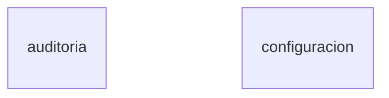

### `auditoria`

Registro de cambios sensibles. Nadie la puede editar ni borrar.

**9 campos** · RLS activo · 1 política · 1 trigger

| # | Campo | Tipo | Longitud / precisión | Nulo | Por defecto | Clave | Referencia | Reglas | Descripción |
|---|---|---|---|---|---|---|---|---|---|
| 1 | `id` | `bigint` | 8 bytes (±9,22 × 10¹⁸) | No |  | PK |  |  | Identificador único |
| 2 | `actor_id` | `uuid` | 16 bytes (36 caracteres en texto) | Sí |  |  |  |  | Quién hizo el cambio (null = el sistema) |
| 3 | `tienda_id` | `uuid` | 16 bytes (36 caracteres en texto) | Sí |  |  |  |  | Para que cada dueño vea lo de su tienda |
| 4 | `accion` | `text` | Sin límite fijo | No |  |  |  |  | INSERT, UPDATE o DELETE |
| 5 | `entidad` | `text` | Sin límite fijo | No |  |  |  |  | Nombre de la tabla |
| 6 | `entidad_id` | `text` | Sin límite fijo | Sí |  |  |  |  | Id del registro afectado |
| 7 | `antes` | `jsonb` | Variable (JSON binario) | Sí |  |  |  |  | Datos del registro antes del cambio, en JSON |
| 8 | `despues` | `jsonb` | Variable (JSON binario) | Sí |  |  |  |  | Datos del registro después del cambio, en JSON |
| 9 | `creado_en` | `timestamptz` | 8 bytes (fecha, hora y zona horaria; precisión de microsegundos) | No | `now()` |  |  |  | Fecha y hora de creación |

**Índices adicionales**

- `auditoria_actor_idx`: `btree (actor_id, id DESC)`
- `auditoria_creado_en_idx`: `btree (creado_en DESC)`
- `auditoria_entidad_entidad_id_idx`: `btree (entidad, entidad_id)`
- `auditoria_entidad_fila_idx`: `btree (entidad, entidad_id, id DESC)`
- `auditoria_entidad_id_idx`: `btree (entidad, id DESC)`
- `auditoria_tienda_id_creado_en_idx`: `btree (tienda_id, creado_en DESC)`

**Triggers**

- `auditoria_inmutable`: Antes de borrar o modificar → `tg_auditoria_inmutable()`

Políticas RLS

| Política | Operación | Roles |
|---|---|---|
| auditoria: superadmin ve todo, el dueño ve su tienda | SELECT | authenticated |

### `configuracion`

Parámetros que el admin cambia sin programar.

**8 campos** · RLS activo · 2 políticas · 2 triggers

| # | Campo | Tipo | Longitud / precisión | Nulo | Por defecto | Clave | Referencia | Reglas | Descripción |
|---|---|---|---|---|---|---|---|---|---|
| 1 | `clave` | `text` | Sin límite fijo | No |  | PK |  |  | Nombre del parámetro (ej.: horas_vencimiento_pedido) |
| 2 | `valor` | `jsonb` | Variable (JSON binario) | No |  |  |  |  | Valor del parámetro, en JSON |
| 3 | `descripcion` | `text` | Sin límite fijo | Sí |  |  |  |  | Descripción |
| 4 | `actualizado_en` | `timestamptz` | 8 bytes (fecha, hora y zona horaria; precisión de microsegundos) | No | `now()` |  |  |  | Última modificación (la actualiza un trigger) |
| 5 | `etiqueta` | `text` | Sin límite fijo | Sí |  |  |  |  |  |
| 6 | `grupo` | `text` | Sin límite fijo | Sí |  |  |  |  |  |
| 7 | `minimo` | `integer` | 4 bytes (±2.147.483.647) | Sí |  |  |  |  |  |
| 8 | `maximo` | `integer` | 4 bytes (±2.147.483.647) | Sí |  |  |  |  |  |

**Reglas de la tabla**

- Regla: (minimo IS NULL) OR (maximo IS NULL) OR (minimo <= maximo)

**Triggers**

- `actualizado_en`: Antes de modificar → `tg_actualizado_en()`
- `auditar`: Después de insertar o borrar o modificar → `tg_auditar()`

Políticas RLS

| Política | Operación | Roles |
|---|---|---|
| configuracion: lectura pública | SELECT | anon, authenticated |
| configuracion: superadmin edita | ALL | authenticated |

---

## 20261001002400_favoritos_portada_busqueda.sql

Archivo: `supabase/migrations/20261001002400_favoritos_portada_busqueda.sql`

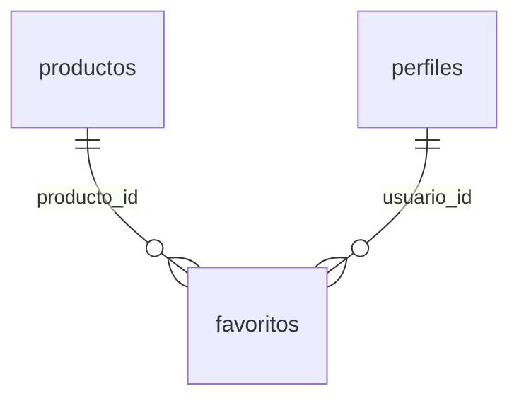

### `favoritos`

Favoritos (tabla + pkg_favoritos) y catálogo de la portada nueva: tarjetas con tienda, portada por localidad, sugerencias del buscador y búsqueda paginada con orden. Convenciones en ..._1800.  Sin sesión, los favoritos viven en el navegador (como el carrito): vista_previa arma la pantalla y unir los pasa a la base al ingresar. Favoritos: un producto guardado por usuario

**3 campos** · RLS activo · 1 política

| # | Campo | Tipo | Longitud / precisión | Nulo | Por defecto | Clave | Referencia | Reglas | Descripción |
|---|---|---|---|---|---|---|---|---|---|
| 1 | `usuario_id` | `uuid` | 16 bytes (36 caracteres en texto) | No |  | PK (compuesta), FK | [perfiles.id (borra en cascada)](#tabla-perfiles) |  | Referencia a perfiles |
| 2 | `producto_id` | `uuid` | 16 bytes (36 caracteres en texto) | No |  | PK (compuesta), FK | [productos.id (borra en cascada)](#tabla-productos) |  | Referencia a productos |
| 3 | `creado_en` | `timestamptz` | 8 bytes (fecha, hora y zona horaria; precisión de microsegundos) | No | `now()` |  |  |  | Fecha y hora de creación |

**Reglas de la tabla**

- Clave primaria compuesta: (usuario_id, producto_id)

**Índices adicionales**

- `favoritos_producto_id_idx`: `btree (producto_id)`
- `favoritos_usuario_creado_idx`: `btree (usuario_id, creado_en DESC)`

Políticas RLS

| Política | Operación | Roles |
|---|---|---|
| favoritos: los propios | ALL | authenticated |

---

## 20261001002900_usuarios_bloqueos.sql

Archivo: `supabase/migrations/20261001002900_usuarios_bloqueos.sql`

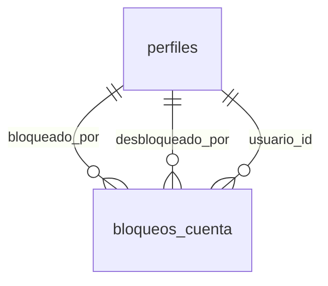

### `bloqueos_cuenta`

Un registro por bloqueo: el vigente es el que no tiene desbloqueado_en. Bloqueos de cuentas por soporte, con su historial

**9 campos** · RLS activo · 3 políticas · 1 trigger

| # | Campo | Tipo | Longitud / precisión | Nulo | Por defecto | Clave | Referencia | Reglas | Descripción |
|---|---|---|---|---|---|---|---|---|---|
| 1 | `id` | `uuid` | 16 bytes (36 caracteres en texto) | No | `gen_random_uuid()` | PK |  |  | Identificador único |
| 2 | `usuario_id` | `uuid` | 16 bytes (36 caracteres en texto) | No |  | FK | [perfiles.id (borra en cascada)](#tabla-perfiles) |  | Referencia a perfiles |
| 3 | `motivo` | `text` | Entre 5 y 500 caracteres | No |  |  |  |  | Motivo |
| 4 | `tiendas` | `jsonb` | Variable (JSON binario) | No | `'[]'` |  |  |  | Tiendas suspendidas por el bloqueo y el estado que tenían: [{id, estado}]. |
| 5 | `bloqueado_por` | `uuid` | 16 bytes (36 caracteres en texto) | Sí |  | FK | [perfiles.id (pone NULL)](#tabla-perfiles) |  | Referencia a perfiles |
| 6 | `bloqueado_en` | `timestamptz` | 8 bytes (fecha, hora y zona horaria; precisión de microsegundos) | No | `now()` |  |  |  | Fecha y hora: bloqueado |
| 7 | `desbloqueado_por` | `uuid` | 16 bytes (36 caracteres en texto) | Sí |  | FK | [perfiles.id (pone NULL)](#tabla-perfiles) |  | Referencia a perfiles |
| 8 | `desbloqueado_en` | `timestamptz` | 8 bytes (fecha, hora y zona horaria; precisión de microsegundos) | Sí |  |  |  |  | Fecha y hora: desbloqueado |
| 9 | `nota_desbloqueo` | `text` | Hasta 500 caracteres | Sí |  |  |  |  |  |

**Índices adicionales**

- `bloqueos_cuenta_bloqueado_por_idx`: `btree (bloqueado_por)`
- `bloqueos_cuenta_desbloqueado_por_idx`: `btree (desbloqueado_por)`
- `bloqueos_cuenta_usuario_idx`: `btree (usuario_id, bloqueado_en DESC)`
- `bloqueos_cuenta_vigente` (único): `btree (usuario_id) WHERE (desbloqueado_en IS NULL)`

**Triggers**

- `auditar`: Después de insertar o borrar o modificar → `tg_auditar()`

Políticas RLS

| Política | Operación | Roles |
|---|---|---|
| bloqueos_cuenta: soporte bloquea | INSERT | authenticated |
| bloqueos_cuenta: soporte desbloquea | UPDATE | authenticated |
| bloqueos_cuenta: soporte ve | SELECT | authenticated |

---

## 20261001003700_seguir_tiendas.sql

Archivo: `supabase/migrations/20261001003700_seguir_tiendas.sql`

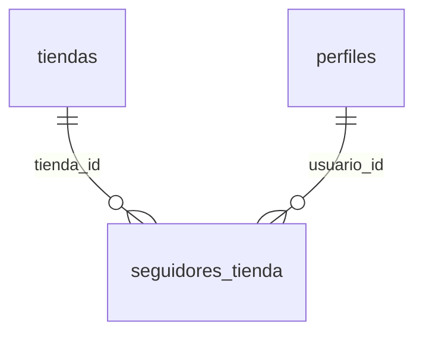

### `seguidores_tienda`

Seguir tiendas (tabla + pkg_seguidos). Con sesión, el cliente sigue las tiendas que le gustan y recibe sugerencias con sus novedades. La página pública de la tienda muestra cuántas personas la siguen. Convenciones en ..._1800.

**3 campos** · RLS activo · 1 política

| # | Campo | Tipo | Longitud / precisión | Nulo | Por defecto | Clave | Referencia | Reglas | Descripción |
|---|---|---|---|---|---|---|---|---|---|
| 1 | `usuario_id` | `uuid` | 16 bytes (36 caracteres en texto) | No |  | PK (compuesta), FK | [perfiles.id (borra en cascada)](#tabla-perfiles) |  | Referencia a perfiles |
| 2 | `tienda_id` | `uuid` | 16 bytes (36 caracteres en texto) | No |  | PK (compuesta), FK | [tiendas.id (borra en cascada)](#tabla-tiendas) |  | Referencia a tiendas |
| 3 | `creado_en` | `timestamptz` | 8 bytes (fecha, hora y zona horaria; precisión de microsegundos) | No | `now()` |  |  |  | Fecha y hora de creación |

**Reglas de la tabla**

- Clave primaria compuesta: (usuario_id, tienda_id)

**Índices adicionales**

- `seguidores_tienda_tienda_id_idx`: `btree (tienda_id)`
- `seguidores_tienda_usuario_creado_idx`: `btree (usuario_id, creado_en DESC)`

Políticas RLS

| Política | Operación | Roles |
|---|---|---|
| seguidores_tienda: los propios | ALL | authenticated |

---

## 20261001004000_rubros.sql

Archivo: `supabase/migrations/20261001004000_rubros.sql`

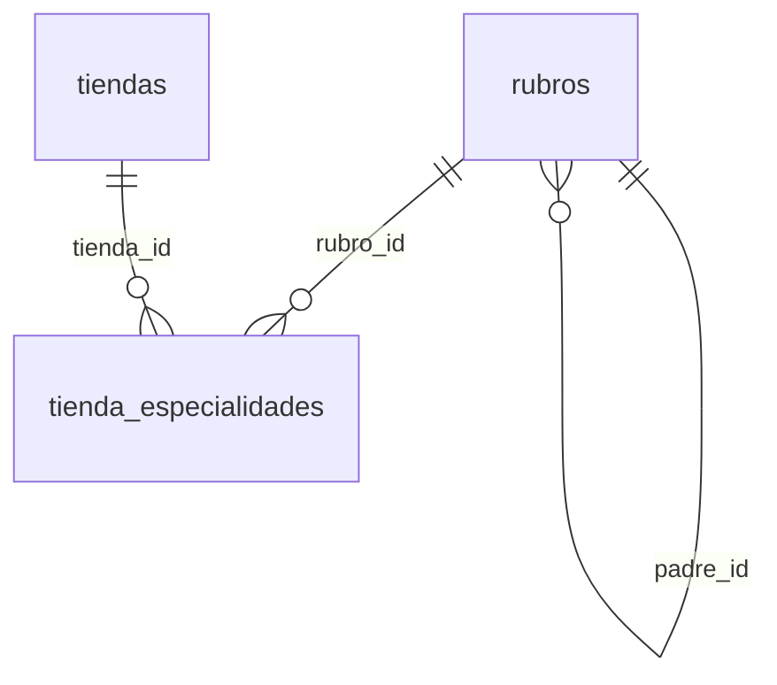

### `rubros`

Rubros: el estándar para clasificar las tiendas. Convenciones en ..._1800.   No reemplaza a las categorías de productos: el rubro describe al negocio. El superadmin mantiene la lista. Un rubro inactivo no se ofrece para elegir, pero las tiendas que ya lo tienen lo conservan. El padre de un rubro no cambia (movido de lugar dejaría tiendas con combinaciones que no existen). La tienda que no lo tiene cargado sigue funcionando: el dueño lo completa cuando edita sus datos. Desde acá, pkg_catalogo.rubro devuelve el declarado (antes se deducía de la categoría con más productos).

**9 campos** · RLS activo · 2 políticas · 3 triggers

| # | Campo | Tipo | Longitud / precisión | Nulo | Por defecto | Clave | Referencia | Reglas | Descripción |
|---|---|---|---|---|---|---|---|---|---|
| 1 | `id` | `uuid` | 16 bytes (36 caracteres en texto) | No | `gen_random_uuid()` | PK |  |  | Identificador único |
| 2 | `padre_id` | `uuid` | 16 bytes (36 caracteres en texto) | Sí |  | FK | [rubros.id (sin acción)](#tabla-rubros) |  | Referencia a rubros |
| 3 | `nombre` | `text` | Sin límite fijo | No |  |  |  |  | Nombre |
| 4 | `slug` | `text` | Sin límite fijo | No |  |  |  |  | Identificador legible para URLs |
| 5 | `nivel` | `smallint` | 2 bytes (±32.767) | No | `1` |  |  | `(nivel >= 1) AND (nivel <= 3)` | Lo calcula la base |
| 6 | `orden` | `integer` | 4 bytes (±2.147.483.647) | No | `0` |  |  |  | Orden en que se muestra |
| 7 | `activo` | `boolean` | 1 byte (verdadero / falso) | No | `true` |  |  |  | Si está habilitado |
| 8 | `creado_en` | `timestamptz` | 8 bytes (fecha, hora y zona horaria; precisión de microsegundos) | No | `now()` |  |  |  | Fecha y hora de creación |
| 9 | `actualizado_en` | `timestamptz` | 8 bytes (fecha, hora y zona horaria; precisión de microsegundos) | No | `now()` |  |  |  | Última modificación (la actualiza un trigger) |

**Reglas de la tabla**

- Regla: padre_id IS DISTINCT FROM id

**Índices adicionales**

- `rubros_nombre_unico` (único): `btree (COALESCE(padre_id, '00000000-0000-0000-0000-000000000000'::uuid), lower(nombre))`
- `rubros_padre_id_idx`: `btree (padre_id, orden)`
- `rubros_slug_unico` (único): `btree (COALESCE(padre_id, '00000000-0000-0000-0000-000000000000'::uuid), slug)`

**Triggers**

- `actualizado_en`: Antes de modificar → `tg_actualizado_en()`
- `auditar`: Después de insertar o borrar o modificar → `tg_auditar()`
- `rubro_nivel`: Antes de insertar o modificar padre_id → `tg_rubro_nivel()`

Políticas RLS

| Política | Operación | Roles |
|---|---|---|
| rubros: el superadmin edita | ALL | authenticated |
| rubros: lectura pública | SELECT | anon, authenticated |

### `tienda_especialidades`

**2 campos** · RLS activo · 2 políticas · 1 trigger

| # | Campo | Tipo | Longitud / precisión | Nulo | Por defecto | Clave | Referencia | Reglas | Descripción |
|---|---|---|---|---|---|---|---|---|---|
| 1 | `tienda_id` | `uuid` | 16 bytes (36 caracteres en texto) | No |  | PK (compuesta), FK | [tiendas.id (borra en cascada)](#tabla-tiendas) |  | Referencia a tiendas |
| 2 | `rubro_id` | `uuid` | 16 bytes (36 caracteres en texto) | No |  | PK (compuesta), FK | [rubros.id (sin acción)](#tabla-rubros) |  | Referencia a rubros |

**Reglas de la tabla**

- Clave primaria compuesta: (tienda_id, rubro_id)

**Índices adicionales**

- `tienda_especialidades_rubro_id_idx`: `btree (rubro_id)`

**Triggers**

- `especialidad_valida`: Antes de insertar o modificar → `tg_especialidad_valida()`

Políticas RLS

| Política | Operación | Roles |
|---|---|---|
| tienda_especialidades: editar con permiso de configuración | ALL | authenticated |
| tienda_especialidades: las de tiendas visibles | SELECT | anon, authenticated |

---

## Esquema auth

En Supabase, `auth.users` la administra Supabase Auth. En PostgreSQL local se simula con `pruebas/supabase_simulado.sql` y contiene solo los campos que usa el proyecto.

### `auth.users`

**5 campos** · RLS **desactivado** · 1 trigger

| # | Campo | Tipo | Longitud / precisión | Nulo | Por defecto | Clave | Referencia | Reglas | Descripción |
|---|---|---|---|---|---|---|---|---|---|
| 1 | `id` | `uuid` | 16 bytes (36 caracteres en texto) | No | `gen_random_uuid()` | PK |  |  | Identificador único |
| 2 | `email` | `text` | Sin límite fijo | Sí |  | Único |  |  | Correo electrónico |
| 3 | `encrypted_password` | `text` | Sin límite fijo | Sí |  |  |  |  | Contraseña cifrada con bcrypt (nunca se guarda en texto plano) |
| 4 | `raw_user_meta_data` | `jsonb` | Variable (JSON binario) | Sí | `'{}'` |  |  |  | Datos del registro (nombre, apellido); el trigger crear_perfil_al_registrarse los copia a perfiles |
| 5 | `created_at` | `timestamptz` | 8 bytes (fecha, hora y zona horaria; precisión de microsegundos) | Sí | `now()` |  |  |  | Fecha y hora de registro |

**Triggers**

- `crear_perfil_al_registrarse`: Después de insertar → `tg_crear_perfil()`

---

## Tipos enumerados

Listas cerradas de valores. Un campo de este tipo solo acepta uno de los valores indicados.

### `estado_cobro`

Usado en: `pagos_suscripcion.estado`

| # | Valor | Significado |
|---|---|---|
| 1 | `pendiente` |  |
| 2 | `aprobado` |  |
| 3 | `rechazado` |  |
| 4 | `reembolsado` |  |

### `estado_denuncia`

Usado en: `denuncias.estado`

| # | Valor | Significado |
|---|---|---|
| 1 | `abierta` |  |
| 2 | `revisada` |  |
| 3 | `descartada` |  |

### `estado_envio`

Usado en: `envios.estado`

| # | Valor | Significado |
|---|---|---|
| 1 | `pendiente` |  |
| 2 | `en_recoleccion` |  |
| 3 | `en_camino` |  |
| 4 | `entregado` |  |
| 5 | `fallido` |  |

### `estado_invitacion`

Usado en: `invitaciones.estado`

| # | Valor | Significado |
|---|---|---|
| 1 | `pendiente` |  |
| 2 | `aceptada` |  |
| 3 | `vencida` |  |
| 4 | `anulada` |  |

### `estado_miembro`

Usado en: `miembros_tienda.estado`

| # | Valor | Significado |
|---|---|---|
| 1 | `invitado` |  |
| 2 | `activo` |  |
| 3 | `suspendido` |  |
| 4 | `retirado` |  |

### `estado_pago`

Usado en: `pagos.estado`

| # | Valor | Significado |
|---|---|---|
| 1 | `pendiente` |  |
| 2 | `aprobado` |  |
| 3 | `rechazado` |  |
| 4 | `reembolsado_parcial` |  |
| 5 | `reembolsado` |  |

### `estado_pago_pedido`

Usado en: `pedidos.estado_pago`

| # | Valor | Significado |
|---|---|---|
| 1 | `pendiente` |  |
| 2 | `aprobado` |  |
| 3 | `rechazado` |  |
| 4 | `reembolsado_parcial` |  |
| 5 | `reembolsado` |  |

### `estado_pedido_tienda`

Usado en: `historial_estados.estado_anterior`, `historial_estados.estado_nuevo`, `pedidos_tienda.estado`

| # | Valor | Significado |
|---|---|---|
| 1 | `pendiente` | esperando el pago |
| 2 | `pago_confirmado` |  |
| 3 | `en_preparacion` |  |
| 4 | `listo_para_recoleccion` | el comercio avisa: el repartidor puede pasar |
| 5 | `listo_para_retiro` | solo con retiro en el local |
| 6 | `recolectado` | el repartidor ya lo retiró de la tienda |
| 7 | `en_camino` |  |
| 8 | `entregado` |  |
| 9 | `cancelado` | lo decidió alguien |
| 10 | `rechazado` | falló el pago |

### `estado_producto`

Usado en: `productos.estado`

| # | Valor | Significado |
|---|---|---|
| 1 | `borrador` |  |
| 2 | `publicado` |  |
| 3 | `pausado` |  |
| 4 | `archivado` |  |

### `estado_reclamo`

Usado en: `reclamos.estado`

| # | Valor | Significado |
|---|---|---|
| 1 | `abierto` |  |
| 2 | `en_revision` |  |
| 3 | `resuelto` |  |
| 4 | `cerrado` |  |

### `estado_recoleccion`

Usado en: `recolecciones.estado`

| # | Valor | Significado |
|---|---|---|
| 1 | `pendiente` |  |
| 2 | `asignada` |  |
| 3 | `recolectada` |  |
| 4 | `fallida` |  |

### `estado_reembolso`

Usado en: `reembolsos.estado`

| # | Valor | Significado |
|---|---|---|
| 1 | `pendiente` |  |
| 2 | `procesado` |  |
| 3 | `rechazado` |  |

### `estado_solicitud_consumidor`

Usado en: `solicitudes_consumidor.estado`

| # | Valor | Significado |
|---|---|---|
| 1 | `recibida` |  |
| 2 | `en_gestion` |  |
| 3 | `resuelta` |  |

### `estado_suscripcion`

Usado en: `suscripciones.estado`

| # | Valor | Significado |
|---|---|---|
| 1 | `pendiente` |  |
| 2 | `activa` |  |
| 3 | `en_gracia` |  |
| 4 | `vencida` |  |
| 5 | `cancelada` |  |
| 6 | `rechazada` |  |

### `estado_tienda`

Usado en: `tiendas.estado`

| # | Valor | Significado |
|---|---|---|
| 1 | `pendiente` |  |
| 2 | `activa` |  |
| 3 | `suspendida` |  |
| 4 | `vencida` |  |
| 5 | `archivada` |  |

### `modalidad_entrega`

Usado en: `pedidos_tienda.modalidad`

| # | Valor | Significado |
|---|---|---|
| 1 | `entrega_plataforma` |  |
| 2 | `retiro_en_local` |  |

### `motivo_pausa`

Usado en: `productos.motivo_pausa`

| # | Valor | Significado |
|---|---|---|
| 1 | `manual` |  |
| 2 | `limite_plan` |  |
| 3 | `moderacion` |  |
| 4 | `revision` |  |
| 5 | `rechazado` |  |

### `rol_plataforma`

Usado en: `roles_plataforma.rol`

| # | Valor | Significado |
|---|---|---|
| 1 | `superadmin` |  |
| 2 | `moderacion` |  |
| 3 | `soporte` |  |
| 4 | `finanzas` |  |
| 5 | `logistica` |  |

### `tipo_atributo`

Usado en: `atributos.tipo`

| # | Valor | Significado |
|---|---|---|
| 1 | `texto` |  |
| 2 | `numero` |  |
| 3 | `lista` |  |
| 4 | `si_no` |  |

### `tipo_solicitud_consumidor`

Usado en: `solicitudes_consumidor.tipo`

| # | Valor | Significado |
|---|---|---|
| 1 | `arrepentimiento` |  |
| 2 | `baja_servicio` |  |
